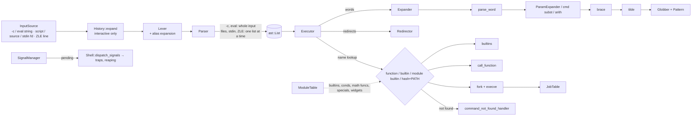
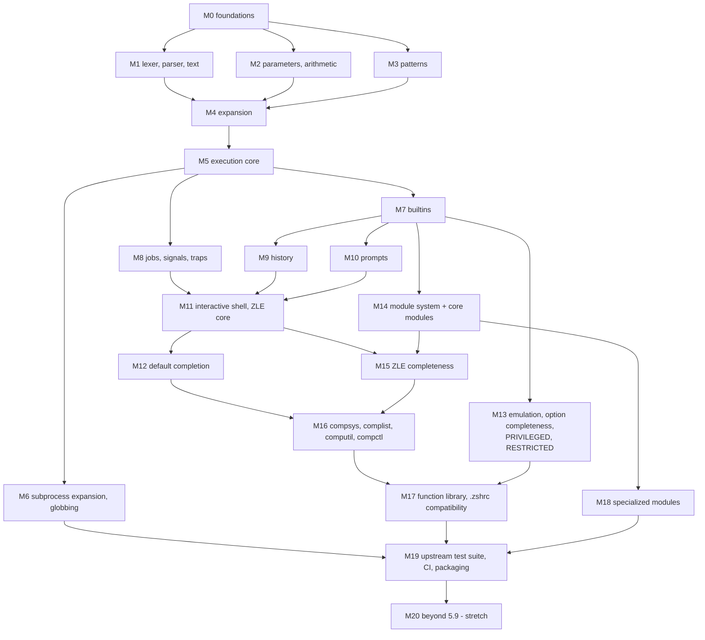

# myzsh implementation plan

A reimplementation of zsh 5.9 in C++26. The repository holds a compiling
skeleton: every header declares the final API, every function body is a stub
that calls `todo("name")` (throws `NotImplemented`) next to a `// TODO(impl):`
comment saying what to build and which part of the zsh source to read. The
tests are complete and currently fail; the work is to make them pass,
milestone by milestone.

The skeleton and its tests cover M0–M12 (the core shell). M13–M19 bring
myzsh to everything zsh 5.9 ships; they have no stubs or tests yet, so each
starts by adding headers, stubs and failing tests in the same style (§3,
"Milestones without a skeleton").

```
make build                      # configure (Ninja if present) + build
make unit FILTER='Lexer*'       # unit tests, optionally filtered
make integration FILTER='*A01*' # .ztst cases against build/src/myzsh
make reference                  # the same .ztst cases against the real zsh
make test                       # everything through ctest
grep -rn "TODO(impl)" src       # what is left (381 markers at the start)
```

---

## 1. Scope

The goal is **full zsh 5.9 compatibility**: a script or `.zshrc` that works
under `zsh -f` works under `myzsh -f` with the same output, and zsh's own
`Test/*.ztst` suite passes (M19). That covers:

- full grammar: lists, pipelines, `&&`/`||`, `!`, `coproc`, subshells,
  `{ }`, `{ } always { }`, `if/elif/else`, `for` (all forms incl. `for ((;;))`
  and `foreach … end`), `select`, `while/until`, `repeat`, `case` with `;;`
  `;&` `;|`, functions (`f()`, `function f`, multiple names, anonymous), `[[ ]]`,
  `(( ))`, `time`, here-docs, here-strings, all redirection operators,
  MULTIOS, `{var}>` fds, short forms (`if [[ ]] { }`, `for i (a b) cmd`),
  CSH_JUNKIE_LOOPS forms (`while …; … end`)
- expansion in zsh order: history, alias, process substitution, parameter
  (all flags, modifiers, subscripts, nested `${${x}}`), command substitution,
  arithmetic, brace expansion, tilde/`=cmd`/named and dynamic named
  directories, globbing (extended/ksh glob, globbing flags, qualifiers,
  `**/`), word splitting, quote removal
- parameters: scalars, integers (with base), floats, arrays, associative
  arrays, typeset attributes, tied parameters, dynamic scoping, every
  special parameter in zshparam(1)
- all 185 options with their code paths (Appendix A), emulation modes
  (`zsh`, `sh`, `ksh`, `csh`) including sticky emulation, PRIVILEGED and
  RESTRICTED shells
- every builtin of the core and of every module zsh ships
- job control, signals, traps (incl. `ZERR`, `DEBUG`, `EXIT`, `TRAPxxx`,
  TRAPS_ASYNC), `time`/`TIMEFMT`/`REPORTTIME`, `TMOUT`
- history (file formats, every option, `!` expansion, `fc` incl. history
  stacks, `zshaddhistory`)
- prompt expansion, spelling correction (CORRECT/CORRECT_ALL, `SPROMPT`)
- interactive shell: startup files, ZLE line editor (every builtin widget,
  emacs/vi keymaps, hooks, `region_highlight`, `zle -F`), completion (the
  compctl-style default and the full compsys framework with `complist`),
  `precmd`/`periodic`/`sched`/mail/`watch` between commands
- the module system (`zmodload` with features and autoload) with every zsh
  5.9 module compiled in (§2.3.12)
- zsh's shell-function library (`Functions/`, `Completion/`) running
  unmodified (§2.3.11)

Out of scope:
- `zcompile` writing `.zwc` files and reading them in `autoload` (the AST is
  a tree, §2.3.1); `zcompile` exists and says so, `autoload` reads the
  source file next to a `.zwc`
- `dlopen` of third-party binary modules (zsh's C module ABI)
- multibyte encodings other than UTF-8
- features newer than 5.9 (named references `typeset -n`, `${| }`/`${ }`
  non-forking substitution, `zsh/ksh93`, `zsh/hlgroup`): M20, stretch

---

## 2. Architecture

### 2.1 Where things came from

| zsh source (Src/)                 | myzsh                                  |
|-----------------------------------|----------------------------------------|
| `main.c`, `init.c`                | `main.cpp`, `shell/shell.*`, `shell/cmdline.*` |
| `options.c`                       | `shell/options.*` (table generated from `optns[]`) |
| `input.c`                         | `parse/input.*` (`InputSource`: string, fd) |
| `lex.c`                           | `parse/lexer.*`, `parse/token.*`       |
| `parse.c` (wordcode)              | `parse/parser.*` → `parse/ast.h` (tree) |
| `text.c`                          | `parse/text.*`                         |
| `exec.c`, `loop.c`                | `exec/executor.*`, `exec/redirect.*`   |
| `hashtable.c`                     | `exec/command_hash.*`, `exec/functions.*`, `shell/alias_table.*`, `builtins/builtin.*` |
| `hashnameddir.c`                  | `shell/named_dirs.*`                   |
| `subst.c`                         | `expand/expander.*`, `expand/param_expand.*`, `expand/word.*`, `expand/tilde.*` |
| `glob.c` (braces, filegen)        | `expand/brace.*`, `glob/glob.*`        |
| `pattern.c`                       | `pattern/pattern.*`                    |
| `hist.c` (modifiers, history)     | `expand/modifiers.*`, `history/history.*` |
| `params.c`                        | `params/param.*`, `params/special.*`, `params/subscript.*` |
| `math.c`                          | `arith/arith.*`                        |
| `cond.c`                          | `cond/cond.*`                          |
| `jobs.c`                          | `jobs/jobs.*` (+ wait/fg logic in `Shell`/executor) |
| `signals.c`                       | `signals/signals.*`                    |
| `prompt.c`                        | `prompt/prompt.*`                      |
| `builtin.c`                       | `builtins/*.cpp`, `builtins/printf_format.*` |
| `utils.c` (quoting, splitting)    | `util/strings.*`                       |
| `utils.c` (`spckword`, correction) | `shell/correct.*` (M11, to add)       |
| `Zle/zle_*.c`                     | `zle/buffer.*`, `zle/keymap.*`, `zle/display.*`, `zle/terminal.*`, `zle/editor.*` |
| `Zle/zle_vi.c`, `zle_move.c` (vi) | `zle/vi.*` (M15, to add)               |
| `Zle/compctl.c` (defaults only)   | `complete/completer.*`                 |
| `Zle/complete.c`, `compcore.c`, `compmatch.c`, `compresult.c` | `complete/compsys/*` (M16, to add) |
| `Zle/computil.c`, `Zle/complist.c`, `Zle/compctl.c` (full) | `modules/computil.*`, `modules/complist.*`, `modules/compctl.*` (M16) |
| `module.c`                        | `modules/module.*` (M14, to add)       |
| `Modules/parameter.c`             | `modules/parameter.*` (M14; until then specials in `params/special.cpp`) |
| `Modules/*.c`, `Zle/zleparameter.c`, `Zle/deltochar.c` | `modules/<name>.*` (M14, M18) |
| `Modules/sched.c`, `Modules/rlimits.c`, `Modules/watch.c` | `builtins/misc.cpp` now; registered as modules in M14 |
| `Functions/`, `Completion/` (shell code) | used unmodified from zsh's install or a vendored copy (§2.3.11) |

### 2.2 Data flow



### 2.3 Design decisions (and why)

1. **Tree AST instead of wordcode.** zsh compiles to flat wordcode so it can
   share text between functions and support `zcompile`. A `std::variant`
   tree is far easier to build, debug and unit test; `zcompile` is out of
   scope. Function bodies are `shared_ptr<const List>` so the function table
   can outlive the parse.
2. **Words stay raw until execution.** The lexer only finds word boundaries
   (it must understand quotes and `$( )` nesting to do so) and keeps the
   source text. `parse_word()` turns it into parts at expansion time. This is
   what zsh effectively does, and it means `eval`, `${(e)x}`, PROMPT_SUBST and
   here-docs reuse the same code path.
3. **`QString` instead of in-band tokens.** zsh marks special characters by
   replacing them with token bytes (`Star`, `Quest`, `Snull`, ...). We carry a
   parallel `quoted` mask; pattern, brace and glob code consult it. Quote
   removal is then just "use `.text`".
4. **One `Shell` object, no globals.** Everything zsh keeps in globals is a
   member of `Shell`, so tests can create many independent shells in-process.
   The constructor is side-effect free; `init()` (real startup) and
   `init_for_test()` (deterministic, no environment, no rc files) do the work.
   The only process-global state is in `SignalManager`, which is unavoidable.
5. **Errors vs. control flow.** zsh's `errflag` becomes `ShellError`
   (thrown by expansion/assignment/redirection, caught per command line —
   fatal in non-interactive shells). `break`/`continue`/`return`/`exit` are
   *not* exceptions: they set `Shell::flow` and every loop/list checks it,
   exactly like zsh's `breaks`/`retflag`, because `always` blocks, traps and
   `LOCAL_*` restoration must run on the way out.
6. **Pure cores for testability.** Things that do not need the shell take
   plain data: `Pattern`, `Globber` (gets `GlobOptions`), modifiers
   (`ModifierContext`), `JobTable` (wait statuses passed in), `LineBuffer`,
   `Keymap`, `layout_line`, `History`. The parts that need state take
   `Shell&`.
7. **Hand-written argv parsing.** zsh's `+x`, clustered `-xv`, `-o name` and
   "first non-option after -c is `$0`" do not fit CLI11; `parse_command_line`
   and `parse_builtin_args` are small and exact.
8. **Error messages are part of the interface.** Tests compare stderr with
   zsh's text (`zsh:1: command not found: x`, `zsh:cd:1: ...`). Messages are
   produced without the prefix; `Shell::report_error` /
   `report_builtin_error` add `NAME:LINE:` / `NAME:builtin:LINE:`. The
   integration runner rewrites the `myzsh:` prefix to `zsh:` so the same
   expectations work for both shells.
9. **The lexer reads from an `InputSource`, not a string.** (Corrected after
   comparing with jfsh; the original skeleton had `Lexer(strv)` and parsed
   every non-interactive input whole, which is only right for `-c`.) zsh
   parses a script file, a `source`d file and stdin **one top-level list at
   a time**, executing each before reading the next (`loop()` in
   `Src/init.c`), so:
   - a parse error at line 5 still runs lines 1–4 (`s.zsh:5: parse error`);
   - an alias defined in a script/sourced file applies to its later lines;
   - with `zsh < script` or `cmd | zsh`, a `read` in the script consumes the
     **next lines of the script** — the shell must not read stdin ahead of
     the parser.
   `-c` and `eval` still parse the whole string first (§6). Design:
   - `parse/input.h`: `InputSource` with `next_char()`, `unget()`,
     `push_text()` (alias text) and `sync_position()`; subclasses supply
     `read_char()`. `StringInput` holds a `str`; `FdInput` reads an fd it
     does not own. `FdInput` on a seekable fd reads in blocks and
     `sync_position()` `lseek`s back over the unconsumed bytes before any
     command runs; on a pipe/tty it reads one byte at a time (zsh's `SHIN`
     handling with `shinbufreset`). Line counting stays in the `Lexer`.
   - `Lexer(InputSource&)`; `Lexer(strv)` stays as a convenience that wraps
     a `StringInput` (tests, `tokenize`, history word splitting).
   - `Parser::parse_line()` ("next complete list, nullopt at EOF") is the
     incremental entry point; `parse_program()` is used for `-c`/`eval`.
   - `Shell::run_input(InputSource&, strv name)` is the shared loop for
     scripts, `source`/`.`, `-s`/stdin and non-ZLE interactive input:
     parse one list → run → `dispatch_signals()` → repeat. Recovery from a
     parse error depends on an `InputKind` argument (see §6): a script
     stops with status 1, a sourced file stops and `source` returns 126,
     stdin skips the bad line and keeps going. `run_file` opens the file
     and calls `run_input`; `run_string` keeps the whole-string behaviour.
   - Lexer and parser must keep no state between lists other than pending
     here-documents and line number, so alias changes take effect at the
     next list.
10. **History tracks what is already on disk.** `History` keeps
    `mSavedUpTo` (the first event number not yet written to `HISTFILE`) and
    the file's size/mtime at the last read. Appending writes only
    `[mSavedUpTo, end)` — writing every entry (what a stateless
    `write_file(append=true)` would do) doubles the file each session, which
    is jfsh bug B5. This state is also what `INC_APPEND_HISTORY`,
    `INC_APPEND_HISTORY_TIME` and `SHARE_HISTORY` need: append one entry
    after each command, and (SHARE) read entries other shells appended since
    the last read. Writes are done under an `fcntl` lock (`HIST_FCNTL_LOCK`)
    or zsh's `$HISTFILE.LOCK` file otherwise; rewrites go through a temp file
    and `rename` unless `HIST_SAVE_BY_COPY` is unset. `fc -p`/`-P` push and
    pop a whole `History` (with its file state) on a stack.
11. **zsh's shell-code library runs unmodified.** `Functions/` (`add-zsh-hook`,
    `vcs_info`, `promptinit`, `run-help`, `zmv`, `edit-command-line`, …) and
    `Completion/` (`compinit`, `_arguments`, `_git`, …) are zsh code, not C.
    myzsh does not rewrite them: the default `$fpath` ends with the
    directories of a vendored copy of zsh 5.9's function tree (CMake cache
    `MYZSH_FUNCTION_DIR`, installed under `share/myzsh/<version>/functions`;
    zsh's licence allows redistribution). Running those files unchanged is
    the compatibility test for M16–M17; a failure is a myzsh bug, never a
    patch to the function.
12. **Modules are compiled in and registered through a table.** zsh's
    `module.c` loads `.so` files and asks each for its *features*
    (builtins `b:`, conditions `c:`, math functions `f:`, parameters `p:`)
    plus hooks and widgets. `modules/module.h` keeps that model —
    `ModuleTable` of `Module { name, features, boot, cleanup }` with
    per-feature enable flags — but every module is linked into the binary;
    `zmodload` only toggles what is visible. Default autoloads are zsh's
    (`zmodload -La` in `zsh -f`: `zsh/zle` for `bindkey`/`zle`/`vared`,
    `zsh/parameter` for `$aliases` etc., `zsh/zutil` for `zstyle`, …), so a
    name is usable without `zmodload` exactly when it is in zsh. Builtins
    that the skeleton already registers in `BuiltinTable` (`sched`,
    `limit`/`ulimit`, `bindkey`, `zle`, `vared`) move behind their module
    in M14 without changing their implementation. Every module feature is
    visible to `whence`, `builtin`, `enable`/`disable` and `$builtins`.
13. **Internal fds live at 10 and above.** The signal self-pipe, saved
    copies of redirected fds, coprocess and `{var}` fds, history lock fds
    and terminal fds are all moved to ≥ 10 with `F_DUPFD_CLOEXEC`, so a
    user's `exec 3<file` can never close one of them (jfsh B63). This is
    zsh's `movefd()`.

### 2.4 Coding conventions

The repository's `format-cpp` skill defines the style: 2-space indent,
`struct` over `class`, `lower_snake_case` functions, `UpperCamelCase` types,
`mMember` for private data, header guards, angle-bracket includes, `not`/
`and`/`or`, explicit enum underlying types, `break; case` switch layout with a
`default`, and the aliases in `src/util/aliases.h` (`str`, `strv`, `vec`,
`opt`, `umap`, `uptr`, `sptr`, `s::`, `sf::`, `sc::`). The stubs follow it.
Remove the `-Wno-unused-private-field -Wno-unused-const-variable` lines in the
top-level `CMakeLists.txt` once the stubs are gone.

---

## 3. Milestones

Each milestone lists the files to fill in and the tests that define "done".
Unit test suites are named after the struct/function they test, so
`make unit FILTER='Lexer*:Parser*'` runs exactly one milestone's tests. Items
marked **(new)** were added after comparing with jfsh's full-zsh plan; their
tests do not exist yet and are written first, checked with `make reference`.



M0–M12 make a usable interactive zsh; M13–M19 make it a complete one.
M13, M14 and M18 can proceed in parallel with M11–M12.

### M0 — foundations
- [ ] `util/strings.cpp`: `split_fields` (note: zsh keeps a trailing empty
      field for a trailing non-whitespace IFS char), `split_on`, `join`,
      `is_identifier`, case helpers, `quote`/`unquote` (port `quotestring()`),
      `interpret_escapes` (print vs echo octal rules), `parse_decimal`
- [ ] `shell/options.cpp`: `lookup_option` (case/underscore-insensitive,
      `no` prefix, but `notify` is not `no`+`tify`; bash/ksh aliases
      `braceexpand dotglob hashall histappend histexpand log mailwarn onecmd
      physical promptvars stdin trackall`), `lookup_option_letter` (port
      `zshletters[]`/`kshletters[]`), `option_default`, `OptionState`
      methods (refuse INTERACTIVE etc.)
- [ ] **(new)** the `Option` enum has 183 entries; zsh 5.9 has 185. Add
      `MULTIBYTE` (default on; off makes `${#x}`, patterns and ZLE count
      bytes) and `RESTRICTED` (`-r`, M13) in `optns[]` order, regenerate the
      table, and add `Options.TableMatchesZsh` comparing names and defaults
      with `zsh -fc 'print -l ${(ko)options}'` output stored in the test
- [ ] `parse/token.cpp`: names, `is_redirection`, `reserved_word`
- Done when: `SplitFields* SplitOn* Join* Is* Case* *Quote* Unquote*
  InterpretEscapes* ParseDecimal* Option* LookupOption* TokenHelpers*`

### M1 — lexer, parser, text
- [ ] `parse/input.cpp`: `InputSource`, `StringInput`, `FdInput`
      (§2.3.9); `FdInput` must never consume bytes the parser has not asked
      for on a non-seekable fd, and must hand back read-ahead on a seekable
      one (`sync_position()` called before executing each list)
- [ ] `Lexer` reads through `InputSource&` via its private `next_char()`/
      `unget()` (the `strv` constructor owns a `StringInput`); `incomplete()`
      means "the source hit EOF mid-construct", which drives PS2 in
      interactive mode and a parse error otherwise
- [ ] `parse/lexer.cpp`: context-sensitive tokens (command position, cond
      mode, case patterns), fd numbers, `EnvString`/`EnvArray`, `((` as one
      String up to `))`, comments, backslash-newline, here-doc queue, alias
      push-back with recursion guard, `incomplete()` for PS2
- [ ] **(new)** lexer options: INTERACTIVE_COMMENTS (`#` starts a comment
      only with it, which `-c`/scripts have on), RC_QUOTES (`''` inside
      `'…'`), CSH_JUNKIE_QUOTES, IGNORE_BRACES / IGNORE_CLOSE_BRACES,
      POSIX_ALIASES (no aliasing of reserved words), SH_GLOB / KSH_GLOB
      (whether `(` inside a word belongs to it), and `disable -r` reserved
      words being plain words
- [ ] **(new)** redirection tokens in full (jfsh B10, B59): `&>`, `&>>`,
      `>&|`, `>&!`, `>>|`, `>>!`, `>!`, `<&-`, `>&-`, `<&p`, `>&p`, fd
      prefixes, `{var}` prefixes; a reserved word as a redirection target
      (`< in`) and `cmd & ;` are not parse errors (B65); the rest of the line
      after `<<EOF` is kept (`cat <<EOF | x`, B62); EOF right after an
      operator terminates (B3); a line longer than any buffer is one line
      (B31)
- [ ] `parse/parser.cpp`: the grammar in §1 including the short forms; error
      text `parse error near `X'`, line numbers, `incomplete` flag;
      `parse_line()` stops after one complete list and leaves the source
      positioned right after it (the newline or `;` is consumed, nothing
      more)
- [ ] **(new)** grammar details checked by jfsh against zsh 5.9: reserved
      words are words outside command position (`for x in if then`, `case`
      patterns, `repeat` counts, anonymous function arguments; B7);
      `{` right after a command word is an argument (`echo {` prints `{`), so
      `if true {` is a parse error while `if [[ x ]] {` and `while (( n )) {`
      work; `}` always closes; `foreach name… (words) … end` and
      `foreach name… in words; … end`; `end` alone is a parse error;
      CSH_JUNKIE_LOOPS (`while c; body; end`); SHORT_LOOPS / SHORT_REPEAT
      gating the single-command bodies; `f() {}` / `function g {}` define an
      empty function; `f() { … } > log` makes the redirections part of the
      body (applied on every call, printed by `functions` after `}`);
      MULTI_FUNC_DEF (`f g () { }`) and ALIAS_FUNC_DEF; `< <(cmd)`,
      `2> >(cmd)`, `< =(cmd)`; reserved-word typeset (`local x=$(cmd)` is
      not split, `local a=(1 2)` makes an array) for `typeset declare export
      float integer local readonly private`; leftover tokens are an error
      (B9); `coproc` with a simple command and with a compound command
- [ ] **(new)** `Parser::context_stack()` for `%_` in PS2/PS4 (`for`,
      `dquote`, `cmdsubst`, `then`, `heredoc`, ...; `Src/lex.c`
      `cmdstack`)
- [ ] `parse/text.cpp`: zsh's `functions` format (tabs, `|&` printed as
      `2>&1 |`), and the one-line job text (`jobs`, `$jobtexts`, `preexec`'s
      `$2` with function bodies elided)
- Done when: `InputSource* FdInput* Lexer* Parser* ParserErrors* Text*`
  (including `Parser.ParseLineIsIncremental` and
  `Parser.ParseLineLeavesRestUnread`)

### M2 — parameters and arithmetic
- [ ] `params/param.cpp`: storage with a per-name definition stack for
      scoping; typed setters honouring attributes (`-i` evaluates arithmetic,
      `-l/-u`, `-L/-R/-Z`, `-U`, readonly → `read-only variable: X`);
      tied scalar/array pairs; environment import/export; `format_float`
      (`%.17g`, `3.` for integral values), `format_integer` (`16#FF`)
- [ ] **(new)** every write path enforces readonly and scoping, not just
      the top-level setter (jfsh B13); the environment emits each name once
      with its innermost exported value (B12)
- [ ] **(new)** remaining attributes: `-h` (hide specialness in a local),
      `-H` (hide value in listings), `-t` (tag), `-E N`/`-F N` precision,
      `-i N` output base, `-T NAME name [sep]` with any separator, `-g`,
      `-x` with GLOBAL_EXPORT, `-p N` (multi-line `typeset -p`),
      KSH_TYPESET, TYPESET_SILENT, TYPESET_TO_UNSET (a bare `typeset x` is
      unset, not empty), ALL_EXPORT, WARN_CREATE_GLOBAL,
      WARN_NESTED_VAR, POSIX_IDENTIFIERS, UNSET / NO_UNSET
- [ ] `arith/arith.cpp`: Pratt parser evaluating as it goes with a no-eval
      flag for short circuits; int64 wrap-around; float promotion; bases
      (`16#ff`, `0x`, `0b`, OCTAL_ZEROES); `##c`/`#name`; all assignment ops;
      `[#16]`/`[##16]`; exact error texts (see `ArithTest.Errors`)
- [ ] **(new)** C_BASES (`0xFF` output), C_PRECEDENCES (C's table instead of
      zsh's, where shifts and bitwise operators bind tighter than `*`),
      FORCE_FLOAT, `_` between digits, `Inf`/`NaN`, KSH_ARRAYS indexing
      in `a[i]`; a math-function hook (`name(args)` resolved through a
      registry) for `functions -M` (M7) and `zsh/mathfunc` (M14)
- [ ] `params/special.cpp`: every special listed in `special.h`
- [ ] **(new)** specials missing from `special.h` (zsh 5.9 marks them
      special in `$parameters`): `FUNCNEST` (default 700), `fignore`/
      `FIGNORE`, `histchars`/`HISTCHARS`, `KEYBOARD_HACK`, `LANG` and
      `LC_ALL LC_COLLATE LC_CTYPE LC_MESSAGES LC_NUMERIC LC_TIME` (assigning
      calls `setlocale`), `mailpath`/`MAILPATH`, `NULLCMD`, `READNULLCMD`,
      `OPTARG`, `OPTIND`, `PROMPT2 PROMPT3 PROMPT4`, `SPROMPT`, `TERM`,
      `TERMINFO`, `TERMINFO_DIRS` (assigning re-reads the terminal),
      `TRY_BLOCK_ERROR`, `TRY_BLOCK_INTERRUPT`, `zsh_eval_context`/
      `ZSH_EVAL_CONTEXT` (`toplevel:shfunc:cmdsubst:…`); and ordinary
      parameters with shell meaning that need defaults or behaviour:
      `ZSH_SCRIPT`, `ZSH_EXECUTION_STRING`, `ZSH_PATCHLEVEL`, `signals`,
      `ERRNO`, `TMOUT`, `TIMEFMT`, `REPORTTIME`, `REPORTMEMORY`,
      `DIRSTACKSIZE`, `LISTMAX`, `MAILCHECK`, `PERIOD`, `POSTEDIT`,
      `PROMPT_EOL_MARK`, `RPS2`/`RPROMPT2`, `STTY`, `TMPPREFIX`,
      `TMPSUFFIX`, `ZBEEP`, `ZDOTDIR`, `ZLE_RPROMPT_INDENT`,
      `ZLE_REMOVE_SUFFIX_CHARS`, `ZLE_SPACE_SUFFIX_CHARS`,
      `ZLE_LINE_ABORTED`, `CORRECT_IGNORE`, `CORRECT_IGNORE_FILE`, `FCEDIT`,
      `ENV`, `HISTORY_IGNORE`, `KEYTIMEOUT`, `BAUD`, `MATCH`/`match`/
      `MBEGIN`/`MEND`/`mbegin`/`mend`, `REPLY`/`reply`
- [ ] **(new)** specials as values in a scope: `local SECONDS` /
      `typeset -F SECONDS` keep the live behaviour; `unset` drops
      specialness for good; `UID EUID GID EGID USERNAME` assignments call
      `setuid`/`seteuid`/`setgid`/`setegid`/`initgroups`
- [ ] `params/subscript.cpp`: index/range/flags; assoc `(i)(I)` match keys,
      `(r)(R)` match values, `(k)(K)` treat keys as patterns; assignment to
      elements and slices (padding, deletion with `()`)
- [ ] **(new)** subscript flags `(e)` exact, `(n:N:)` Nth match, `(b:N:)`
      begin at, `(w)` / `(s:sep:)` / `(p)` / `(f)` word indexing of a
      scalar; flags on the left of an assignment (`a[(i)x]=y`,
      `h[(r)v]=…`, `a[(I)pat]=()`); KSH_ARRAYS and KSH_ZERO_SUBSCRIPT;
      `h[k]=v cmd` prefix assignments and `typeset h[k]=v`
- [ ] `Shell::init_for_test()` (needed by most tests from here on)
- Done when: `ParamTableTest* FormatNumbers* MathNumber* ArithTest*
  SpecialParamTest* ParseSubscript* SubscriptEvalTest*`

### M3 — patterns
- [ ] `pattern/pattern.cpp`: compile to nodes, backtracking matcher with
      captures; `[...]` incl. POSIX classes, `<n-m>`, alternation, extended
      glob (`^ ~ # ##`, `(#i/I/l/b/m/aN/s/e)`), ksh glob, file mode;
      prefix/suffix/search with shortest/longest
- [ ] **(new)** the rest of the globbing flags: `(#B)`, `(#M)`, `(#q…)`
      (qualifiers inside an extended pattern), `(#u)`/`(#U)` (multibyte on/
      off), `(#cN,M)` repetition, `(#a1)` approximation with zsh's
      error-counting rules (transposition, insertion, deletion, substitution;
      used by `_approximate`); `(#b)` fills `$match`/`$mbegin`/`$mend`,
      `(#m)` fills `$MATCH`/`$MBEGIN`/`$MEND`; `[[:IDENT:]]`, `[[:IFS:]]`,
      `[[:IFSSPACE:]]`, `[[:WORD:]]` (uses `WORDCHARS`), `[[:INCOMPLETE:]]`,
      `[[:INVALID:]]`; CASE_MATCH, CASE_GLOB, CASE_PATHS (5.9),
      `disable -p` / `$patchars` turning individual operators off,
      LOCAL_PATTERNS restoring them, BAD_PATTERN
- [ ] **(new)** MULTIBYTE: match by UTF-8 character, not byte
- Done when: `Pattern* HasGlobChars*`

### M4 — expansion (no subprocesses yet)
- [ ] `expand/word.cpp`, `expand/brace.cpp`, `expand/tilde.cpp`,
      `expand/modifiers.cpp`
- [ ] `expand/param_expand.cpp`: parser for `${...}` and the expansion rules
      of zshexpn(1) "Rules" section, in order
- [ ] **(new)** checklist so "all flags" is not left vague (zshexpn(1),
      "Parameter Expansion Flags"): `# % @ A AA a b B c C D e E f F g:opts:
      i I:n: k l:n::s1::s2: L m M n N o O p P q qq qqq q- q+ Q r:…: R s:x:
      S t u U v V w W X z Z:opts: 0 ~ j:x: _`; operators `- = ? +` with and
      without `:`, `::=`, `# ## % %%`, `/ // /# /% :/`, `:offset:length`,
      `${name:#pat}`, `${name:|arr}` (difference), `${name:*arr}`
      (intersection), `${name:^arr}` / `${name:^^arr}` (zip), `${^x}` /
      `${^^x}`, `${=x}` / `${==x}`, `${~x}` / `${~~x}`, `${+x}`, `${#x}`,
      `$name[sub]` without braces; `${x:-*.c}` globs the default word while
      `${x:-"*.c"}` and `${x:-$y}` do not
- [ ] **(new)** modifiers (zshexpn(1) "Modifiers"): `a A c e h[N] t[N] l u
      p q Q r P s/l/r/ gs/l/r/ & g& x X f F:n: w W:sep:` with
      HIST_SUBST_PATTERN (`:s` takes a pattern); `:x`/`:G`/`:p` are
      history-only and say `unrecognized modifier` in `${}`
- [ ] **(new)** tilde in full: `~+N`/`~-N`/`~N` (directory stack), named
      directories from `hash -d` and AUTO_NAME_DIRS, CDABLE_VARS-style
      lookups, **dynamic named directories** `~[name]` through the
      `zsh_directory_name` function and `zsh_directory_name_functions`
      (and the reverse mapping used by `%~` and `(D)`); `=cmd` with EQUALS;
      MAGIC_EQUAL_SUBST; SH_FILE_EXPANSION ordering; POSIX_STRINGS
      (`$'\0'` ends the string)
- [ ] `expand/expander.cpp`: prefork, splitting, `"$@"`, RC_EXPAND_PARAM,
      empty-word removal, assignment/scalar/pattern/heredoc contexts
- [ ] **(new)** SH_WORD_SPLIT, GLOB_SUBST, GLOB_ASSIGN, KSH_ARRAYS (`$a`
      is `$a[0]`), MULTIBYTE in `${#x}`/`(c)`/offsets
- Done when: `ParseWord* BraceExpansion* TildeTest* *Modifiers*
  ParseParamExpr* ParamExpandTest*` and the non-subprocess part of
  `ExpanderTest*`

### M5 — execution core (first runnable shell)
- [ ] `shell/cmdline.cpp`, `main.cpp` flow, `Shell::init/run/run_string/
      run_file/report_error`
- [ ] `Shell::run_input(InputSource&, strv name)` (§2.3.9): the
      incremental loop used by script files, `source`/`.`, `-s` and stdin;
      `run_string` (whole parse) only for `-c` and `eval`. Pinned by
      `Shell.RunStringParsesWholeStringFirst`,
      `Shell.RunInputRunsListsBeforeParseError`,
      `Shell.RunFileAliasAppliesToLaterLines`,
      `Shell.RunInputLeavesUnparsedStdinForRead`,
      `Shell.RunInputSyncsSeekableStdin`,
      `Shell.RunInputSourcedParseErrorIs126`,
      `Shell.RunInputStdinRecoversFromParseError`
- [ ] `builtins/builtin.cpp`: `parse_builtin_args`, `BuiltinTable` with
      every name, flags (`BF_SPECIAL`, `BF_ASSIGN`, `BF_PREFIX`)
- [ ] `exec/command_hash.cpp`, `exec/functions.cpp`, `exec/redirect.cpp`
- [ ] **(new)** redirection details: internal fds ≥ 10 (§2.3.13); a new fd
      that lands on the target number is moved off before closing (jfsh
      B64); MULTIOS input concatenation (`cat <a <b` reads both); CLOBBER /
      CLOBBER_EMPTY / APPEND_CREATE / HIST_ALLOW_CLOBBER's `>|`; `{var}>`
      allocation (fd ≥ 10 in `$var`, not closed automatically),
      `{var}>&-`; `>&p`/`<&p` to the coprocess; NULLCMD / READNULLCMD for
      `> f` / `< f` alone, SH_NULLCMD and CSH_NULLCMD
- [ ] `exec/executor.cpp`: lists, sublists, pipelines (last stage in the
      current shell!), simple commands with precommand modifiers, every
      compound command, functions with scoping, assignments, ERR_EXIT/
      ERR_RETURN, XTRACE, `exec_external` (127/126, ENOEXEC → run as script)
- [ ] **(new)** executor details: `command_not_found_handler` (called with
      the command words, its status is the command's); AUTO_CD (a directory
      name alone is `cd`); PATH_DIRS, PATH_SCRIPT, HASH_CMDS / HASH_DIRS /
      HASH_EXECUTABLES_ONLY; suffix aliases (`alias -s pdf=open` runs
      `open x.pdf`); `exec -a name / -l / -c`, `command -p`, `noglob`,
      `nocorrect`, `-`; `coproc` (fork, `$!`, fds for `read -p`/`print -p`
      and `>&p`, a new coproc closes the old one's input); anonymous
      functions (`$0` is `(anon)`, arguments fully expanded);
      FUNCTION_ARGZERO / POSIX_ARGZERO, FUNCNEST (`maximum nested function
      level reached`), LOCAL_OPTIONS / LOCAL_LOOPS / LOCAL_PATTERNS /
      LOCAL_TRAPS restored on return; `always` with `TRY_BLOCK_ERROR` /
      `TRY_BLOCK_INTERRUPT`; `$ZSH_SUBSHELL`, `$ZSH_EVAL_CONTEXT`,
      `$funcstack`/`$funcfiletrace`/`$funcsourcetrace`/`$functrace`;
      VERBOSE, NO_EXEC (`-n`), SOURCE_TRACE, EVAL_LINENO, PRINT_EXIT_VALUE,
      CONTINUE_ON_ERROR, PIPE_FAIL, ERR_EXIT exemptions (B33),
      DEBUG_BEFORE_CMD; `$LINENO` in a function counted from its
      definition; a forked pipeline stage's HASH_CMDS entry is lost, as in
      zsh; deep recursion up to FUNCNEST=700 must not overflow the C++
      stack — run the executor on a thread with a large stack or raise
      `RLIMIT_STACK` at startup (jfsh crashed between 1500 and 3000 levels,
      and at 700 under ASan)
- [ ] builtins needed for testing: `: true false print echo exit return
      break continue eval source . set setopt unsetopt typeset local`
- Done when: `CommandLine* Shell* ParseBuiltinArgs* BuiltinTable*
  CommandHashTest* FunctionTable* LoadAutoload* RedirectTest* ExecutorTest*`
  and integration `A01*`–`A07*` mostly pass (`make integration FILTER='*A0*'`),
  including the new `A08input.ztst` (script / stdin modes, see §5)

### M6 — subprocess expansions and globbing
- [ ] command substitution, `$( )` status, process substitution
      (`/dev/fd/N` kept open until the command ends), `=( )` temp files
      (`TMPPREFIX`, `TMPSUFFIX`)
- [ ] `glob/glob.cpp`: directory walking, `**/` `***/`, qualifiers, sorting,
      NULL_GLOB/NOMATCH/CSH_NULL_GLOB, MARK_DIRS, GLOB_DOTS, GLOB_SUBST
- [ ] **(new)** every qualifier (zshexpn(1) "Glob Qualifiers"): `/ . @ = p
      * % %b %c r w x A I E R W X s S t f:spec: e:string: +cmd d:dev:
      l[-+]n U G u:id: g:id: a/m/c[Mwhms][-+]n L[kKmMpPgGtT][-+]n ^ - M T N
      D n o[nLlamcdN] O… [beg,end] P:string: Y:n: :modifiers`, the `#q`
      form, BARE_GLOB_QUAL, GLOB_STAR_SHORT (`**.c`), NUMERIC_GLOB_SORT,
      CASE_GLOB, EXTENDED_GLOB, KSH_GLOB, SH_GLOB, NO_GLOB (`set -F`),
      CSH_NULL_GLOB (empty only if every pattern of the command failed),
      `fignore` for completion only, RM_STAR_SILENT / RM_STAR_WAIT
      (`zsh: sure you want to delete all N files in /x [yn]?`, interactive)
- Done when: `ExpanderTest* GlobTest* ParseGlobQualifiers*`, integration
  `D02* D03* D07* D08*`

### M7 — builtins
- [ ] `builtins/printf_format.cpp` (`FormatPrintf*`)
- [ ] every `bi_*` in `builtins/*.cpp`, in roughly this order: output
      (`print`, `echo`, `printf`), vars (`typeset` family incl. `-p` output,
      `unset`, `set`, `let`), options (`setopt`, `emulate`), dirs (`cd`,
      `pushd`, `popd`, `dirs`, `pwd`), lookup (`whence` family), aliases,
      hash, functions/autoload, read, getopts, test, misc (`umask`, `ulimit`,
      `limit`, `times`, `enable`, `zmodload`)
- [ ] **(new)** flags that are easy to miss (each checked against zsh 5.9):
      - `print -z` (push to the editor buffer), `-s`/`-S` (history), `-p`
        (coprocess), `-v`, `-x`/`-X` (tab expansion), `-D`, `-P`, `-f`,
        `-C`/`-a`/`-c`/`-l`/`-m`/`-N`/`-o`/`-O`/`-i`/`-b`/`-u`
      - `read -z` (editor buffer stack), `-c`/`-l`/`-n` (completion
        widgets), `-p` (coprocess), `-k N`, `-q`, `-s`, `-d`, `-t`, `-u`,
        `-e`/`-E`, `-A`, `name?prompt`
      - `typeset` attributes from M2; `functions -M` (math functions, with
        `-s` string functions), `-T`/`-t` (per-function xtrace), `-W`
        (WARN_NESTED_VAR per function), `-c` (copy), `-u`, `+m`
      - `autoload -U -z -k -X -w -d -r -R -t -T -m`, `+X` (load now);
        KSH_AUTOLOAD; `$fpath` search that skips `.zwc` (out of scope)
      - `cd -q -s -L -P`, POSIX_CD, CDABLE_VARS, CD_SILENT, CHASE_DOTS /
        CHASE_LINKS, AUTO_PUSHD, PUSHD_* options, `DIRSTACKSIZE`; `chpwd`
        and `chpwd_functions`
      - `hash -d` (named directories, fills `$nameddirs`), `-f`, `-L`, `-m`,
        `-r`, `-v`; `unhash -a -d -f -m -s`
      - `enable` / `disable -a -f -m -p -r -s` (aliases, functions,
        patterns, reserved words, suffix aliases)
      - `whence -a -c -f -m -p -s -S -v -w -x N`, `where`, `which`, `type`
      - `emulate -L -R -c`, `emulate -l`; `setopt -m`, KSH_OPTION_PRINT
      - `jobs -d -l -p -r -s -Z`; `kill -L`; `disown` warning for stopped
        jobs; `suspend -f`; `wait` statuses
      - `ttyctl -f / -u` (freeze terminal modes), `bye`, `logout`
        (`not login shell`), `pushln`, `getln`, `shift -p`, `set -A/+A/-s`
      - `zcompile` (exists, reports that `.zwc` is unsupported, status 1)
- [ ] **(new)** errors in special builtins (`set -o nosuch`, `unset ro`)
      exit a non-interactive shell under POSIX_BUILTINS; assignments
      before special builtins persist only under POSIX_BUILTINS
- [ ] **(new)** default aliases `run-help=man`, `which-command=whence`
- [ ] `cond/cond.cpp` (`CondTest*`)
- [ ] **(new)** `[[ ]]` details: `=~` sets `$MATCH`/`$match`/`$MBEGIN`/
      `$MEND`/`$mbegin`/`$mend` (character offsets); BASH_REMATCH fills
      `$BASH_REMATCH` instead and leaves `$MATCH` alone; REMATCH_PCRE uses
      PCRE2 (through `zsh/pcre`, M14); module conditions
      (`-pcre-match`, `-regex-match`, completion's `-after`/`-between`/
      `-prefix`/`-suffix`) dispatched through the module table; an unquoted
      `[[ -n ]]` alone is `unknown condition: -n` (status 2, fatal when
      non-interactive) while `[[ $x ]]` with `x=-n` is a string test;
      `-o` with an unknown option is status 3
- Done when: `Zsh/BuiltinTest*` (121 cases), `CondTest*`, integration
  `B0* C01* C02* C04* D04* D05* D06* E0*`

### M8 — jobs, signals, traps
- [ ] `jobs/jobs.cpp` bookkeeping and formatting (`[1]  + running    cmd`)
- [ ] `signals/signals.cpp`: names, `TrapTable`, `SignalManager` (handler
      only records; `Shell::dispatch_signals` acts at safe points)
- [ ] executor/shell: process groups and terminal hand-off with MONITOR,
      `wait_for_job`, async notification, `fg bg jobs wait disown kill
      suspend trap` builtins, EXIT/ZERR/DEBUG traps, `TRAPxxx` functions,
      LOCAL_TRAPS
- [ ] **(new)** remaining job/trap behaviour: TRAPS_ASYNC (run traps while
      waiting for a child), POSIX_TRAPS (EXIT in a function), POSIX_JOBS,
      AUTO_CONTINUE (disowned stopped jobs get SIGCONT), AUTO_RESUME
      (a bare word resumes a matching job), LONG_LIST_JOBS, BG_NICE,
      CHECK_JOBS / CHECK_RUNNING_JOBS, HUP, NOTIFY; a stopped command inside
      a loop turns the rest of the loop into a suspended job of its own;
      a background pipeline lists each stage's pid in `jobs -l`;
      `$jobstates`/`$jobtexts`/`$jobdirs` (served by `zsh/parameter`, M14)
- [ ] **(new)** `time` (reserved word): reports only for forked jobs, and
      with no pipeline reports the shell's own times; `$TIMEFMT` escapes
      (`%E %U %S %P %J %M %F %R %W %X %D %K %I %O %r %s %w %c` and `%mE`,
      `%uE`); `$REPORTTIME` and `$REPORTMEMORY` thresholds report any
      pipeline that exceeds them
- [ ] **(new)** `TMOUT`: interactive shell exits (or runs `TRAPALRM`) after
      `TMOUT` idle seconds at the prompt; `TRAPALRM` with `TMOUT` also
      reschedules itself
- Done when: `JobTableTest* DescribeWaitStatus* WaitStatus* SignalNames*
  TrapTable* SignalManager*`, integration `C03* W02*`

### M9 — history
- [ ] `history/history.cpp`: storage + options, file read/write (extended
      format, continuation lines), search, `!` expansion with designators
      and modifiers, `^a^b`
- [ ] history file state (§2.3.10): `mSavedUpTo`, last-read size/mtime;
      replace the stateless `write_file(append)` with
      `append_new(path, options)` (only unsaved entries), `rewrite(path,
      limit, options)` (SAVEHIST trim, temp file + rename) and
      `read_new(path)` (entries appended by other shells, for
      SHARE_HISTORY); `fcntl`/`.LOCK` locking; INC_APPEND_HISTORY(_TIME)
      and SHARE_HISTORY wired into `run_interactive`
- [ ] **(new)** the remaining options: HIST_EXPIRE_DUPS_FIRST, HIST_LEX_WORDS
      (`!$` and `fc` split words with the lexer), HIST_NO_FUNCTIONS,
      HIST_NO_STORE, HIST_REDUCE_BLANKS, HIST_FIND_NO_DUPS,
      HIST_SAVE_NO_DUPS, HIST_IGNORE_SPACE (the line stays until the next
      one so `!!` still finds it), HIST_BEEP, HIST_SUBST_PATTERN,
      CSH_JUNKIE_HISTORY (a reference with no event, like `!:1`, always
      means the previous command rather than the event of the previous
      reference on the same line), BANG_HIST, `$HISTORY_IGNORE`
      pattern, metafied bytes in the file
- [ ] **(new)** the `zshaddhistory` hook (and `zshaddhistory_functions`):
      status 1 keeps the line out of history, 2 keeps it in memory only;
      `$history` / `$historywords` (M14); a line enters history before it
      runs, so `$HISTCMD` is its number and `r`/`fc -s` replace it with the
      command they run
- [ ] `fc`/`history`/`r` builtins, `print -s`, HISTFILE load/save in
      `Shell::init`/`exit_shell`
- [ ] **(new)** `fc -p [file [size [savesize]]]` / `fc -P` history stacks
      (and `fc -a` auto-pop on function exit), `fc -I -L -t fmt -E -f -i -D`
- Done when: `HistoryTest* SplitHistoryWords*` (including
  `AppendAcrossSessionsDoesNotDuplicate`, `ReadNewSeesOtherShellsEntries`,
  `GetOutOfRange`, `IgnoreAllDupsKeepsNewest`), integration `W01*`

### M10 — prompts
- [ ] `prompt/prompt.cpp`: all escapes, conditionals, truncation, colours,
      width accounting, PROMPT_SUBST/PERCENT/BANG
- [ ] **(new)** escapes jfsh found easy to miss: `%_` (parser context, from
      M1's `context_stack()`, so PS2's default `%_> ` shows `for> `),
      `%^` (reverse context), `%G` (glitch count inside `%{…%}`), `%e`,
      `%I`/`%x` (source line/file in PS4), `%N`, `%(V..)`/`%(N v...)` on
      `$psvar`, `%R`/`%r` in `SPROMPT`, `%D{…}` with zsh's `%f %K %L %.`
      extensions, `#rrggbb` colours (mapped by `zsh/nearcolor` when loaded,
      M18); `%F` re-emitted after `%b`; PROMPT_CR / PROMPT_SP with
      `$PROMPT_EOL_MARK`; `(%)` and `(%%)` expansion flags share this code
- Done when: `PromptTest* DisplayWidth*`, integration `D01*`

### M11 — interactive shell and ZLE core
- [ ] `zle/buffer.cpp`, `zle/keymap.cpp` (default keymaps from
      `Zle/zle_bindings.c`), `zle/display.cpp`, `zle/terminal.cpp`,
      `zle/editor.cpp` (widgets listed in `editor.h`, user widgets with
      `BUFFER`/`CURSOR`/`LBUFFER`/`RBUFFER` specials), `bindkey`, `zle`,
      `vared`
- [ ] `Shell::run_interactive`: startup files (§4), PS1/RPS1/PS2, precmd/
      preexec/chpwd hooks, IGNORE_EOF, CHECK_JOBS, job notifications,
      HUP on exit, history integration, history expansion of input lines
      (HIST_VERIFY: put the expanded line back in the editor instead of
      running it). Each prompt cycle, in zsh's order (`Src/init.c` `loop()`,
      `preprompt()`): `dispatch_signals()` → job notifications → `precmd`
      functions → `periodic` when `$PERIOD` has elapsed → `sched` events due
      → mail check (`MAIL`/`MAILPATH`, every `MAILCHECK` seconds) → prompt
- [ ] **(new)** hook arrays `precmd_functions`, `preexec_functions`,
      `chpwd_functions`, `periodic_functions`, `zshexit_functions`,
      `zshaddhistory_functions` next to the plain functions; `preexec` gets
      the line, the elided single-line text (M1) and the full text; mail
      checks handle maildirs, `file?message` with `$_`, MAIL_WARNING;
      `zshexit` runs after the EXIT trap
- [ ] `sched` builtin and its event queue (`Modules/sched.c`, compiled in),
      also checked while ZLE waits for a key; **(new)** `sched -o` clears
      and redraws the line; `$zsh_scheduled_events`
- [ ] `Shell::preprompt`, `run_sched_events`, `check_mail`, `bi_sched`
      (events in `Shell::sched_events`)
- [ ] ZLE must stay responsive to signals: `Terminal::read_byte` and the
      editor's `KeySource` return a `KeyRead` whose status separates
      `Byte`, `EndOfFile`, `Interrupted` and `TimedOut` (one `nullopt` for
      all of them invites jfsh bug B29: a closed tty spinning at 100% CPU).
      On `Interrupted` the editor runs `dispatch_signals()`; with NOTIFY a
      job finishing prints its status above the prompt and redraws;
      SIGWINCH calls `LineEditor::resize`, which updates `$COLUMNS`/`$LINES`
      and redraws
- [ ] Ctrl-C at the prompt (`send-break`) discards the line and redraws;
      Ctrl-C / Ctrl-Z during a foreground job reach only the job (the shell
      has its own process group and ignores SIGINT/SIGTSTP/SIGTTOU while
      interactive)
- [ ] bracketed paste (`bracketed-paste` widget, `zle_bracketed_paste`)
- [ ] **(new)** UTF-8 in the editor (jfsh B25): the cursor moves by
      character, a base character and its combining marks are one
      (COMBINING_CHARS), widths from `wcwidth()`; `main` sets the locale
      from the environment; PRINT_EIGHT_BIT for listings
- [ ] **(new)** spelling correction (`Src/utils.c` `spckword`, new
      `shell/correct.*`): CORRECT for command names, CORRECT_ALL for every
      argument, `SPROMPT` (`zsh: correct 'sl' to 'ls' [nyae]? `) answered
      `n y a e`, `CORRECT_IGNORE`, `CORRECT_IGNORE_FILE`, DVORAK distance,
      `nocorrect` precommand modifier
- [ ] **(new)** terminal options: FLOW_CONTROL (`^S`/`^Q` passed to the
      editor when off), `STTY` applied around external commands,
      `ttyctl -f` frozen modes restored after each command, BEEP / `ZBEEP`,
      SINGLE_LINE_ZLE, ZLE / NO_ZLE (falls back to `run_input` on the tty)
- Done when: `LineBuffer* KeySequence* Keymap* DefaultKeymaps* KeymapSet*
  Display* EditorTest* TerminalTest* Shell.SchedEventRunsFromPreprompt`,
  and the pty tests (§5) pass

### M12 — default completion
What zsh does with no `compinit`: the compctl defaults.
- [ ] `complete/completer.cpp`: context classification, commands/files/
      parameters/options/users, common prefix, column listing; wire to
      `expand-or-complete`, `list-choices`, `menu-complete`
- [ ] **(new)** the options this path honours: AUTO_LIST, AUTO_MENU,
      MENU_COMPLETE, LIST_AMBIGUOUS, LIST_BEEP, LIST_PACKED,
      LIST_ROWS_FIRST, LIST_TYPES, BASH_AUTO_LIST, REC_EXACT,
      COMPLETE_IN_WORD, ALWAYS_TO_END, ALWAYS_LAST_PROMPT,
      AUTO_PARAM_KEYS, AUTO_PARAM_SLASH, AUTO_REMOVE_SLASH, COMPLETE_ALIASES,
      GLOB_COMPLETE, `$LISTMAX` ("do you wish to see all N possibilities"),
      `fignore`; completion replaces the word at the cursor, found by a
      shell-aware tokenizer (jfsh B28); named directories, `cdpath` dirs
      after `cd`
- [ ] **(new)** `expand-word`, `expand-or-complete` expanding globs and
      `$vars` in place, `list-expand`, `expand-cmd-path`, `spell-word`,
      `delete-char-or-list`, `complete-word`, `reverse-menu-complete`,
      `accept-and-menu-complete`
- Done when: `CompleterTest* CompletionHelpers*`

### Milestones without a skeleton (M13–M20)

These have no headers, stubs or tests yet. Each starts by adding them in the
skeleton's style (`todo()` bodies with `// TODO(impl):` notes, failing unit
tests, `.ztst` cases verified with `make reference`), so the milestone is
again "make the tests pass". Port the matching upstream `Test/*.ztst` file
(§5) at the same time.

### M13 — emulation, option completeness, PRIVILEGED, RESTRICTED
Every option has its flag from M0; this milestone makes sure each one also
has its behaviour (Appendix A lists where each is implemented).
- [ ] `emulate [-LR] zsh|sh|ksh|csh [-c cmd]` and `emulate -l [mode]`
      (sourceable list of options that differ); `-R` resets every non-special
      option; `-L` implies LOCAL_OPTIONS, LOCAL_TRAPS, LOCAL_PATTERNS
- [ ] **sticky emulation**: a function defined inside `emulate MODE -c '…'`
      (or autoloaded with `autoload -z`/`-k` under it) records MODE and its
      options, and runs under them whenever it is called (zshbuiltins(1)
      `emulate`, `Src/exec.c` `sticky`)
- [ ] invocation name (`argv[0]` basename minus a leading `-`): `sh`/`ash`/
      `dash`/`bash` → sh, `ksh*` → ksh, `csh`/`tcsh` → csh; the emulation is
      set before any rc file
- [ ] sh/ksh startup: read `/etc/profile` and `~/.profile` for login shells
      and `$ENV` for interactive ones instead of the zsh files; default
      prompts (`$ ` / `# `)
- [ ] POSIX_* options: POSIX_ALIASES, POSIX_ARGZERO, POSIX_BUILTINS,
      POSIX_CD, POSIX_IDENTIFIERS, POSIX_JOBS, POSIX_STRINGS, POSIX_TRAPS
- [ ] KSH_* / SH_* / CSH_* options: KSH_ARRAYS, KSH_AUTOLOAD, KSH_GLOB,
      KSH_OPTION_PRINT, KSH_TYPESET, KSH_ZERO_SUBSCRIPT, SH_FILE_EXPANSION,
      SH_GLOB, SH_NULLCMD, SH_OPTION_LETTERS, SH_WORD_SPLIT, BSD_ECHO,
      CSH_JUNKIE_HISTORY, CSH_JUNKIE_LOOPS, CSH_JUNKIE_QUOTES,
      CSH_NULL_GLOB, CSH_NULLCMD
- [ ] PRIVILEGED (`-p`, and automatically when real and effective ids
      differ): skip the user's startup files, use `/etc/suid_profile` for sh
      emulation, don't import functions or `$ENV`, reset `IFS`; unsetting it
      drops the effective ids
- [ ] RESTRICTED (`-r`, or invoked as `rzsh`): no `cd`, no changing `PATH`
      `path` `FPATH` `fpath` `MODULE_PATH` `module_path` `ENV` `HISTFILE`
      `SHELL` `USERNAME` `LD_*`, no command names with `/`, no `>` / `>>`
      redirections, no `exec`, `hash -p`, `builtin`, `enable`/`disable`,
      `set +r`, `zmodload`; enforced after startup files are read
- Done when: new `Emulate*`, `Privileged*`, `Restricted*` unit tests and
  integration `B07emulate E03posix P01privileged` (ported from zsh) pass

### M14 — module system and core modules
The design is §2.3.12. New files `modules/module.*` and one
`modules/<name>.*` per module, tests `test/unit/modules/<name>_test.cpp`.
- [ ] `ModuleTable`: features (`b:` builtins, `c:` conditions, `f:` math
      functions, `p:` parameters), boot/cleanup, per-feature enable,
      dependencies (`zmodload -d`), aliases (`zmodload -A`, `-R`), autoload
      marks that load on first use (the executor, cond evaluator, arithmetic
      evaluator and parameter lookup all consult them)
- [ ] `zmodload [-abcdeFiIlLmpuUR] [-A|-R alias=name] [name …]` with zsh's
      listings (`-L`, `-l -F`, `-La`) and messages (`failed to load module:
      x`, `no such feature: y`); `$module_path`/`MODULE_PATH` searched only
      for the name check; `$modules`
- [ ] zsh's default autoloads, verbatim from `zsh -f -c 'zmodload -La'`:
      `zsh/zle` (bindkey zle vared), `zsh/complete` (compadd compset;
      conds `-after -between -prefix -suffix`), `zsh/computil`
      (comparguments compdescribe compfiles compgroups compquote comptags
      comptry compvalues), `zsh/compctl` (compctl compcall), `zsh/termcap`
      (echotc, `$termcap`), `zsh/terminfo` (echoti, `$terminfo`),
      `zsh/rlimits` (limit ulimit unlimit), `zsh/watch` (log, `$watch`,
      `$WATCH`), `zsh/param/private` (private), `zsh/sched` (sched,
      `$zsh_scheduled_events`), `zsh/zutil` (zformat zparseopts
      zregexparse zstyle), `zsh/zleparameter` (`$keymaps`, `$widgets`),
      `zsh/parameter` (all its parameters)
- [ ] re-register the skeleton's `sched`, `limit`/`ulimit`/`unlimit`,
      `bindkey`/`zle`/`vared` under their modules (no behaviour change)
- [ ] `zsh/parameter`: `aliases builtins commands dirstack dis_aliases
      dis_builtins dis_functions dis_functions_source dis_galiases
      dis_patchars dis_reswords dis_saliases funcfiletrace funcsourcetrace
      funcstack functions functions_source functrace galiases history
      historywords jobdirs jobstates jobtexts modules nameddirs options
      parameters patchars reswords saliases userdirs usergroups` — live
      views; assigning to `$functions[f]`, `$aliases[a]`, `$options[o]`
      etc. changes the table, `unset` removes
- [ ] `zsh/datetime`: `strftime [-nqrs] fmt [secs [nsecs]]` (and `-r`
      reverse through `strptime`), `$EPOCHSECONDS`, `$EPOCHREALTIME`,
      `$epochtime`
- [ ] `zsh/mathfunc`: every function (`abs acos acosh asin asinh atan atanh
      cbrt ceil copysign cos cosh erf erfc exp expm1 fabs float floor fmod
      gamma hypot ilogb int isinf isnan j0 j1 jn ldexp lgamma log log10
      log1p log2 logb nextafter rint scalb signgam sin sinh sqrt tan tanh
      y0 y1 yn rand48`) through M2's math-function hook
- [ ] `zsh/zutil`: `zstyle` (all forms incl. `-e`, `-L`, `-d`, `-g`, `-s`,
      `-b`, `-a`, `-t`, `-T`, `-m`; most specific pattern wins by zsh's
      weighting), `zformat -f` / `-a`, `zparseopts -D -E -F -K -M -a -A`
      with `name+:`, `name::`, `name:-`, `=array` specs, `zregexparse`
- [ ] `zsh/system`: `syserror`, `sysopen`, `sysread`, `syswrite`, `sysseek`,
      `zsystem flock / supports`, `$errnos`, `$sysparams`
- [ ] `zsh/files` (not autoloaded): builtin `chgrp chmod chown ln mkdir mv
      rm rmdir sync` and their `zf_*` names
- [ ] `zsh/stat` (`zstat`/`stat`): every element, `-A -H -f -g -l -L -n -N
      -o -r -s -t -T -F fmt +element`
- [ ] `zsh/regex` (`-regex-match`, the default `=~`) and `zsh/pcre`
      (`pcre_compile -aimxs`, `pcre_study`, `pcre_match -v -a -n -b`,
      `-pcre-match`, REMATCH_PCRE), PCRE2 found by CMake, stubs when absent
- [ ] `zsh/langinfo` (`$langinfo`), `zsh/mapfile` (`$mapfile`),
      `zsh/param/private` (`private`, PM_HIDE scoping rules),
      `zsh/termcap`, `zsh/terminfo`, `zsh/zleparameter`, `zsh/watch`
      (`$watch`, `$WATCHFMT`, `$LOGCHECK`, `log`), `zsh/newuser`
      (`zsh-newuser-install` runs for an interactive shell with no startup
      files), `zsh/deltochar` (`delete-to-char`, `zap-to-char`), `zsh/main`
      and `zsh/rlimits` as names
- Done when: `Module*` unit tests and the ported `V01zmodload
  V02zregexparse V03mathfunc V04features V05styles V06parameter V07pcre
  V09datetime V10private V12zparseopts V13zformat Z02zmathfunc` pass

### M15 — ZLE completeness
Everything ZLE has beyond M11; `zle/vi.*` is new.
- [ ] every builtin widget in zshzle(1) "Standard Widgets" (check with
      `zle -la` in `zsh -f`), including `vi-*`, `*-match` support for
      `select-word-style`, `push-input`, `push-line-or-edit`,
      `accept-line-and-down-history`, `infer-next-history`,
      `history-beginning-search-*`, `history-incremental-pattern-search-*`,
      `copy-prev-shell-word`, `insert-last-word` with numeric args,
      `quote-line`, `quote-region`, `what-cursor-position`,
      `describe-key-briefly`, `where-is`, `execute-named-cmd`,
      `execute-last-named-cmd`, `recursive-edit`, `read-command`,
      `split-undo`, `undo` with change numbers, `visual-mode`,
      `visual-line-mode`, `deactivate-region`, `beep`, `auto-suffix-*`
- [ ] keymaps `emacs viins vicmd viopp visual isearch command .safe main`
      (`main` is viins when `$VISUAL`/`$EDITOR` contains `vi`); `bindkey
      -e -v -a -M -l -L -N -A -D -d -r -s -R -p` with zsh's listing format;
      `bindkey -s` macros; KEYTIMEOUT; numeric arguments
- [ ] vi mode: operators with motions, counts on both, text objects
      (`iw aw iW aW` and the shell-word `ia aa` from `select-in-shell-word`),
      registers `"a`–`"z`/`"A`–`"Z`/`"_`/`"0`–`"9` and `$registers`, marks,
      `.` repeat with a new count, replace mode, `vi-pound-insert`
- [ ] user-widget parameters (zshzle(1) "User-Defined Widgets"):
      `BUFFER BUFFERLINES CONTEXT CURSOR CUTBUFFER HISTNO ISEARCHMATCH_ACTIVE
      ISEARCHMATCH_START ISEARCHMATCH_END KEYMAP KEYS KEYS_QUEUED_COUNT
      killring LASTABORTEDSEARCH LASTSEARCH LASTWIDGET LBUFFER MARK NUMERIC
      PENDING POSTDISPLAY PREBUFFER PREDISPLAY RBUFFER REGION_ACTIVE
      region_highlight registers SUFFIX_ACTIVE SUFFIX_START SUFFIX_END
      UNDO_CHANGE_NO UNDO_LIMIT_NO WIDGET WIDGETFUNC WIDGETSTYLE YANK_ACTIVE
      YANK_START YANK_END ZLE_RECURSIVE ZLE_STATE`
- [ ] special widgets (hooks): `zle-line-init`, `zle-line-pre-redraw`,
      `zle-line-finish`, `zle-history-line-set`, `zle-isearch-update`,
      `zle-isearch-exit`, `zle-keymap-select`; `add-zle-hook-widget` (M17)
      relies on their names
- [ ] `zle -N -C -D -A -l [-L -a] -M -U -K -F [-L|-w] fd [handler] -I -R
      [-c] -T [tc func | -r tc | -L] -f flag`, `zle widget -n num -N -K
      keymap -w`; `$WIDGET` inside; `zle -F` fd handlers run while waiting
      for a key (async plugins); `vared -a -A -c -e -f -h -i -M -m -p -r
      -t`, and `vared` inside a widget
- [ ] highlighting: `$region_highlight` entries `start end spec [memo=…]`
      with `P` prefix for PREDISPLAY offsets, `$zle_highlight`
      (`region isearch special suffix paste default`), specs `fg= bg= bold
      underline standout none` with names, numbers and `#rrggbb` — so the
      zsh-syntax-highlighting and zsh-autosuggestions plugins (which use
      `region_highlight`, `POSTDISPLAY` and widget wrapping) work unmodified
- [ ] display: `RPROMPT`/`RPS1`/`RPS2`, TRANSIENT_RPROMPT,
      `ZLE_RPROMPT_INDENT`, `POSTDISPLAY`/`PREDISPLAY`, OVERSTRIKE,
      completion lists below the line, minimal redraw for very long
      buffers, reflow after SIGWINCH of a multi-row prompt (jfsh B26, B27)
- [ ] `edit-command-line`-style editing through `$VISUAL`/`$EDITOR` is a
      function (M17); `run-help` and `which-command` widgets call the
      aliases from M7
- Done when: new `Vi*`, `ZleHook*`, `RegionHighlight*` tests and the
  ported `X02zlevi X03zlebindkey X04zlehighlight X05zleincarg` pass

### M16 — completion system (compsys)
- [ ] `zsh/complete`: `compadd` with every option (`-a -A -C -d -D -e -E -f
      -F -i -I -J -k -l -M -n -o -O -p -P -q -Q -r -R -s -S -U -V -W -x
      -X -1 -2`), `compset -p -P -s -S -n -N -q`, `compcall`; the
      `$compstate` association (`context exact exact_string ignored insert
      insert_positions last_prompt list list_lines list_max nmatches
      old_insert old_list parameter pattern_insert pattern_match quote
      quoting redirect restore to_end unambiguous unambiguous_cursor
      unambiguous_positions vared`), `$words`, `$CURRENT`, `$PREFIX`,
      `$SUFFIX`, `$IPREFIX`, `$ISUFFIX`, `$QIPREFIX`, `$QISUFFIX`,
      `$compstate` writes steering insertion and listing; the `-C`
      completion widgets (`zle -C name complete-word _main_complete`)
- [ ] matching control (`compmatch.c`): `-M 'm:{a-z}={A-Z}' 'r:|[._-]=*'
      'l:|=*' 'b:…' 'e:…'` specs, used by `matcher-list`
- [ ] `zsh/computil`: `comparguments compdescribe compfiles compgroups
      compquote comptags comptry compvalues` (the C halves of
      `_arguments`, `_describe`, `_path_files`, `_tags`, `_values`)
- [ ] `zsh/complist`: `menu-select` and `listscroll` widgets, the
      `menuselect` and `listscroll` keymaps, `$LISTPROMPT`, `$MENUPROMPT`,
      `$MENUSELECT`, `$MENUSCROLL`, `ZLS_COLORS`/`ZLS_COLOURS` and the
      `list-colors` style, interactive mode and search inside the menu
- [ ] `zsh/compctl` in full: `compctl` with every flag including `-x`
      extended conditions and `+` alternatives, `-L` listing
- [ ] `compinit` from zsh's own `Completion/` runs unmodified (§2.3.11):
      `.zcompdump`, `compaudit` security warnings, `compdef`, `bashcompinit`
- Done when: the ported `Y01completion Y02compmatch Y03arguments` pass,
  plus pty tests: `git <Tab>`, `ls -<Tab>`, `cd <Tab>` with menu selection
  produce zsh's screen

### M17 — function library and `.zshrc` compatibility
- [ ] default `$fpath` (§2.3.11) and `make install` of the vendored
      function tree; `autoload -U` of every name in it works
- [ ] zsh's functions run unmodified, tested one by one: `add-zsh-hook`,
      `add-zle-hook-widget`, `is-at-least`, `promptinit` + `prompt -l` +
      every bundled `prompt_*_setup` theme, `vcs_info` (git, hg, svn
      backends; `zstyle ':vcs_info:*'`), `run-help` + `run-help-*`,
      `colors`, `zmv`/`zcp`/`zln`, `zargs`, `zcalc`, `zed`,
      `edit-command-line`, `bracketed-paste-magic`, `url-quote-magic`,
      `select-word-style` + the `*-match` widgets,
      `up/down-line-or-beginning-search`, `history-search-end`, `cdr` +
      `chpwd_recent_dirs`, `zsh-mime-setup`, `zkbd`, `zrecompile` (copes
      with `zcompile` failing), `checkmail`, `harden`, `nslookup`,
      `tetris` (as a ZLE stress test)
- [ ] system rc files: `/etc/zshenv`, `/etc/zprofile`, `/etc/zshrc`,
      `/etc/zlogin`, `/etc/zlogout` (and the `/etc/zsh/` variants on Linux,
      chosen at configure time as zsh does); see §7 for user file names
- [ ] real-world corpus: the default `.zshrc` of oh-my-zsh, prezto, zim
      and a powerlevel10k configuration start a prompt with no errors and
      the same `typeset -p`/`setopt`/`bindkey -L` state as zsh
- Done when: `Z01is-at-least Z03run-help` pass, every listed function has a
  `.ztst` case run with `make reference`, and the corpus test passes

### M18 — specialized modules
Each registered, not autoloaded, as in zsh.
- [ ] `zsh/zpty` (`zpty -e -b -d -w -n -r -m -t -L`; the command runs in a
      forked copy of the shell on a pty) — also useful for our own pty tests
- [ ] `zsh/net/tcp` (`ztcp`, and the `tcp_*` functions of M17),
      `zsh/net/socket` (`zsocket`)
- [ ] `zsh/zftp` (`zftp` with every subcommand, sessions, `$ZFTP_*`; the
      `zf*` function suite on top)
- [ ] `zsh/curses` (`zcurses`, `$ZCURSES_*`, `$zcurses_*`)
- [ ] `zsh/db/gdbm` (`ztie`, `zuntie`, `zgdbmpath`) when GDBM is found
- [ ] `zsh/attr` (`zgetattr zsetattr zdelattr zlistattr` over macOS/Linux
      xattr), `zsh/cap` (Linux libcap), `zsh/clone`, `zsh/zselect`,
      `zsh/zprof`, `zsh/nearcolor`, `zsh/example`
- Done when: `V08zpty V11db_gdbm` and new per-module tests pass

### M19 — upstream test suite, CI, packaging
- [ ] port every `Test/*.ztst` of zsh 5.9 (list in §5) into
      `test/integration/cases`, extending the runner for the directives it
      lacks (`%clean`, `ZTST_skip`, `ZTST_getsplit`, `zpty`-driven ZLE
      tests via M18); the line for "full zsh compatibility" is every case
      passing that passes under `make reference` on the same machine
- [ ] CI matrix: Linux (gcc, clang) and macOS (Apple clang), Debug,
      Release, ASan+UBSan; `make reference` run against the installed zsh
- [ ] benchmarks against zsh: startup with `-f` and with an oh-my-zsh
      `.zshrc`, prompt latency, a 50 000-entry history file, a loop of
      10⁶ arithmetic ops, globbing a large tree; myzsh within 20% of zsh
- [ ] packaging: `make install` (`bin/myzsh`, `share/myzsh/<ver>/functions`,
      man page), `/etc/shells` entry, Homebrew formula
- Done when: all ported upstream tests pass on Linux and macOS

### M20 — beyond zsh 5.9 (stretch)
- named references (`typeset -n`, zsh 5.10), `${| … }` and `${ … }`
  non-forking substitution (`D10nofork`), `zsh/ksh93`, `zsh/hlgroup`
- `zcompile` / `.zwc` (would need a serialized AST format)
- `dlopen` of third-party modules through zsh's C module ABI

---

## 4. Startup and shutdown (Shell::init / run / exit_shell)

1. parse argv (`parse_command_line`); `argv[0]` starting with `-` → login;
   basename `sh`/`ksh`/`csh` → emulation (M13), `rzsh`/`-r` → RESTRICTED
2. options: emulation defaults, then command-line settings; INTERACTIVE
   defaults to "stdin and stderr are ttys and no -c/script"; PRIVILEGED
   when real and effective ids differ
3. import environment, install specials, `SHLVL++`, fix `PWD`
4. signals (`SignalManager::install`), terminal and job control when
   interactive (own process group, `tcsetpgrp`)
5. startup files unless NO_RCS (`-f`), each global file skipped with
   NO_GLOBAL_RCS: `/etc/zshenv` → `$ZDOTDIR/.zshenv` → (login)
   `/etc/zprofile`, `.zprofile` → (interactive) `/etc/zshrc`, `.zshrc` →
   (login) `/etc/zlogin`, `.zlogin`. `ZDOTDIR` defaults to `$HOME` and is
   re-read before each file. sh/ksh emulation reads `/etc/profile`,
   `~/.profile`, `$ENV` instead; PRIVILEGED skips the user's files. An error
   in a startup file abandons that file, not the shell.
   While developing, run with `-f` or a private `ZDOTDIR` so your real zsh
   configuration is not executed by a half-finished shell.
6. RESTRICTED takes effect; `zsh-newuser-install` for an interactive shell
   with no user startup files (M14)
7. dispatch: `-c` (whole string parsed first, `run_string`); script file
   and `-s`/stdin (one list at a time, `run_input` over an `FdInput`);
   interactive loop (ZLE, or `run_input` on stdin when not a tty / NO_ZLE)
8. exit: save history, `.zlogout` then `/etc/zlogout` for login shells,
   EXIT trap, `zshexit` hooks, SIGHUP (and SIGCONT) to jobs unless NO_HUP or
   disowned

---

## 5. Testing

### Layout
- `test/unit/*_test.cpp` — GoogleTest, one file per module (~710 tests).
  Tests that need a shell call `test::make_shell()` (uses `init_for_test`);
  `test::run(shell, script)` captures fds 1 and 2; `test::TempDir` and
  `test::ScopedCwd` isolate filesystem tests.
- `test/unit/builtins_test.cpp` — 121 table-driven builtin cases run
  in-process. `python3 test/unit/check_builtin_cases.py /bin/zsh` re-checks
  the whole table against a real zsh (all 121 currently match zsh 5.9).
- `test/integration/cases/*.ztst` — 365 end-to-end cases in zsh's own test
  format, run by `integration_tests` as `myzsh -f -c '...'` in a fresh
  temporary directory. `make reference` runs them against the real zsh;
  all 365 pass there, so any failure against myzsh is a myzsh bug.

### Input modes in the integration runner
By default a case runs as `-c`, which parses the whole string first and so
cannot catch incremental-parsing bugs (§2.3.9). Two status-line flags
select the other modes, run identically for myzsh and zsh so
`make reference` validates them:
- `s` — PREP+CODE is written to a file outside the working directory and
  run as `shell -f FILE`; the file's path is shown as `case.zsh` in
  stdout/stderr (`$0`, error prefixes);
- `i` — PREP+CODE followed by the `<` lines is fed on stdin to `shell -f`,
  so a command in the code that reads stdin gets what follows it.

`A08input.ztst` covers: parse errors in each mode, aliases defined in a
script/sourced file (and not under `-c`), `read` and `cat` consuming the
rest of a stdin script, multi-line constructs and here-docs in stdin mode,
`$0` and `exit` in scripts.

### Interactive tests through a pty (to add)
ZLE, job control and signal handling cannot be tested through `-c`.
Add `test/interactive/` driving `myzsh -f -i` under `forkpty` with
`TERM=dumb` and a fixed size: send keys, wait for a prompt marker
(`PS1=$'\n%%PROMPT%% '`), assert on output. Cases: Ctrl-C at the prompt
discards the line; Ctrl-C during `sleep 10` kills only `sleep`; Ctrl-Z
then `fg`; `NOTIFY` message while editing; SIGWINCH updates `$COLUMNS`;
closing the pty master makes the shell exit (not spin); multi-line PS1 is
not reprinted per keystroke; bracketed paste inserts text without running
it; CORRECT prompts; `TMOUT` exit; RM_STAR_WAIT; menu selection (M16).
For screen-level checks, feed the output to a small terminal emulator in
the test (jfsh's `editor_test.cpp` does this) instead of matching raw
escape sequences. Run the same scenarios against zsh where the output is
comparable.

### Upstream zsh test files to port (M19, and per milestone)
zsh 5.9's `Test/` directory, with the milestone that should make each pass.
Our existing cases use similar names but are not copies; port the upstream
file next to them (`upstream/` subdirectory) rather than merging.

| upstream file | milestone | upstream file | milestone |
|---|---|---|---|
| A01grammar … A07control | M5 | D07multibyte | M4/M11 |
| B01cd B02typeset B03print B04read | M7 | D08cmdsubst D09brace | M6/M4 |
| B05eval B06fc B08shift B09hash | M7/M9 | E01options E02xtrace | M7 |
| B07emulate | M13 | E03posix | M13 |
| B10getopts B11kill B12limit B13whence | M7/M8 | P01privileged | M13 |
| C01arith C02cond C04funcdef | M7 | V01–V13 (modules) | M14/M18 |
| C03traps C05debug | M8 | W01history | M9 |
| D01prompt | M10 | W02jobs W03jobparameters | M8/M14 |
| D02glob D03procsubst | M6 | X02–X05 (ZLE) | M15 |
| D04parameter D05array D06subscript | M4/M2 | Y01–Y03 (completion) | M16 |
| | | Z01–Z03 (functions) | M14/M17 |

### .ztst format (subset of zsh's)
```
%prep
  setup code, prepended to every test in the file (it shifts line numbers)
%test

<stdin line
  code (indented two spaces)
0:description            status, or - for any; flags d/D skip stdout/stderr,
>expected stdout          f marks a known failure (skipped)
?expected stderr
F:note shown on failure
```

### Workflow per milestone
1. `make unit FILTER='Suite*'` until green
2. `make integration FILTER='*A0*'` for the matching end-to-end cases
3. when adding a behaviour test, run it through `make reference` (or
   `check_builtin_cases.py`) first so the expectation is zsh's, not a guess
4. `make SANITIZE=ON test` before calling a milestone done

---

## 6. Behaviour notes found while writing the tests

Checked against zsh 5.9; each is pinned by a test.

- `zsh -c` parses the **entire** string before running anything: a parse
  error later in the script means nothing runs, and aliases defined in the
  script do not apply to later lines of the same `-c` string (use `eval`).
- Script files, `source`/`.` and stdin are the opposite: parsed and run
  one list at a time. `zsh -f s.zsh` with a parse error on line 5 prints
  lines 1–4's output, then `s.zsh:5: parse error near `('`, status 1; an
  alias defined on line 2 works on line 3. `printf 'read x\nhello\necho
  got=$x\n' | zsh -f` prints `got=hello`.
- What a parse error does depends on where the input came from: a script
  stops (`s.zsh:2: parse error near `)'`, exit 1); a sourced file stops
  with the same message and `source` returns **126** while the caller
  continues; on stdin (`-s` or a pipe) the message has **no line number**
  (`zsh: parse error near `)'`), the bad line is skipped, `$?` is 1 and
  reading continues — the exit status is that of the last command.
- In a non-interactive shell an expansion error (`${x:?}`, no glob match,
  bad math) aborts the whole script with status 1 — `always` blocks do not
  get a chance. Builtin `break` outside a loop is fatal too.
- The **last** element of a pipeline runs in the current shell
  (`echo x | read v` sets `v`); `jobs` on the left of a pipe sees an empty
  job table.
- `${x:?}` with no message says `x: parameter not set` even when `x` is set
  but empty.
- IFS splitting keeps a trailing empty field for a trailing non-whitespace
  delimiter: `IFS=:; x=a:b:` → `a b ''`.
- `(t)` of a special exported parameter is `scalar-export-special`.
- `${(V)x}` renders a tab as `\t`, not `^I`.
- `time` only reports for jobs that fork: `time true` prints nothing.
- `|&` is printed by `functions` as `2>&1 |`.
- `set -o` lists default-on options in their `no` form (`noglob off`).
- `%b` in a prompt resets all attributes (`\e[0m`) and then re-emits the
  active colours.
- `echo` needs `\0NNN` for octal; `print` accepts `\NNN` and `\0NNN`.
- printf numeric arguments are arithmetic expressions: `abc` → 0 silently,
  `1x` → error message, prints 0, status 1.
- zsh always defines aliases `run-help=man` and `which-command=whence`.
- `cd` into a CDPATH directory prints it only when interactive.
- `fc -W` writes nothing in a non-interactive shell that never stored
  history; `print -s` entries are visible to `fc -l` though.
- Assoc subscripts: `(i)/(I)` match keys, `(r)/(R)` match values, `(k)/(K)`
  use the stored keys as patterns against the subscript.
- `zsh -f` has 185 options (`${(ko)options}`); `multibyte` and `restricted`
  are among them. Under `zsh -f`, `zmodload -L` lists only `zsh/main`, yet
  `zstyle`, `compadd`, `$aliases`, `$widgets` work: they are autoload
  marks (`zmodload -La`), not loaded modules.

### From jfsh, to verify against zsh 5.9 before pinning
jfsh recorded these as zsh behaviour; check each with `make reference`
when its milestone adds the test.
- `echo {` prints `{`; `if true {` is a parse error, `if [[ x ]] {` is not.
- `end` alone is a parse error; `foreach x (a b) … end` works.
- `f() { … } > log` applies the redirection on every call and `functions f`
  prints it after the closing brace.
- `[[ -n ]]` (unquoted, alone) is `unknown condition: -n`, status 2.
- `:x` and `:G` in `${…}` give `unrecognized modifier`.
- BASH_REMATCH: a match fills `$BASH_REMATCH` and leaves `$MATCH`/`$match`
  untouched; a failed match leaves `$BASH_REMATCH` alone.
- `test a '<' b` and `test -o opt`: jfsh says zsh 5.9 rejects them.
- A stopped command inside a loop turns the rest of the loop into a
  suspended job.
- `$LINENO` in a function counts from the line its definition starts on.
- An error in a startup file of a non-interactive shell abandons that
  file only.
- Exit order: history saved, logout files, EXIT trap, `zshexit`.

### Pitfalls found in jfsh (`../jeff/jfsh/TODO.md` Part 2)

A sibling reimplementation hit these; each deserves a test here.
- Options: `nomatch` and `notify` are real names, not `no`+`match` /
  `no`+`tify`; the caller must learn whether a `no` prefix negated (B15).
- Lexer: fd-number prefixes belong to the redirection (`2>&1` is not word
  `2` + `>&1`, B10); `&>`, `&>>`, `>&-`, `<&-` lex as one operator (B59);
  the rest of the line after `<<EOF` must survive (B62); keywords are words
  outside command position (B7); unget at EOF must not underflow (B3).
- Redirections: internal fds must not sit on 3–9 (B63: `exec 3<file`
  closed the signal self-pipe and the next SIGCHLD killed the shell with
  SIGPIPE); a new fd landing on the target number must be moved off before
  the close (B64).
- Parameters: every path that writes a parameter must honour readonly and
  the scope (B13); the environment must hold each name once (B12).
- Jobs: job number 0 must never be handed out if 0 means "free" (B4);
  `kill` of a process group must reject pgid ≤ 1 (B17, signals init or
  the shell itself); `%+`/`%-` must be updated when a job is reaped (B41);
  `waitpid` for foreground jobs needs `WUNTRACED` or Ctrl-Z hangs the
  shell (B14).
- History: append mode doubling the file (B5, §2.3.10); `get(0)`
  out-of-bounds (B6); HIST_IGNORE_ALL_DUPS removes the **older** entry and
  keeps the new one (B58); HIST_NO_STORE must not skip the duplicate checks
  (B40).
- Prompt: `%~` must match `$HOME` on a path-component boundary
  (`/Users/ab` is not `~b`) and read `HOME` from the shell's parameters,
  not `getenv` (B36, B61); widths count display columns, not bytes (B25);
  re-read `PS1` before every prompt (B38).
- ZLE: Ctrl-C at the prompt (B24), EOF from the terminal (B29), redraw of
  multi-line prompts (B26), SIGWINCH (B27), completion inserts relative to
  the word being completed, not the line (B28); without a terminal the
  prompt goes to stderr (B54).
- ERR_EXIT is applied by the executor with zsh's exemptions, never by the
  REPL on every line (B33).
- Unimplemented builtins must fail loudly — myzsh's `todo()` throws, keep
  it that way rather than returning 0 (B19).
- Modules: a module table that is never instantiated, or has no default
  search path, makes `zmodload` silently useless (B53); autoload marks must
  actually load on first use (jfsh's executor never consulted them).
- Recursion: the C++ stack limits function depth before FUNCNEST does
  (§M5).

---

## 7. Open questions to settle while implementing

- Startup file names: keep zsh's (`.zshrc`) for fidelity, or add a CMake
  option for a prefix (e.g. `.myzshrc`) during development? (jfsh chose its
  own names plus an opt-in flag to read zsh's; for myzsh, whose goal is
  `.zshrc` compatibility, zsh's names are the end state.)
- Locale: tests run with `LC_ALL=C`; decide how far to go with UTF-8 width
  and case conversion (zsh uses `wcwidth`/`towupper`). MULTIBYTE (M0) and
  the UTF-8 items of M3/M4/M11 assume UTF-8 locales work fully.
- Signal numbers differ between macOS and Linux; tests avoid hard-coding
  them (SIGUSR1 is 30 on macOS, 10 on Linux) — keep it that way.
- Vendoring zsh's `Functions/` and `Completion/` (§2.3.11): pin to the 5.9
  tag in a `third_party/zsh-functions` directory, or fetch at configure
  time?
- Modules that need libraries (PCRE2, GDBM, ncurses, libcap): required,
  optional with stubs (jfsh's choice), or vendored?

---

## Appendix A — where each option gets its behaviour

All 185 options, by the milestone that implements what they do (the flag
itself is M0). An option listed here and not yet covered by a test is a gap.

- **M1 lexer/parser:** ALIASES ALIAS_FUNC_DEF CSH_JUNKIE_LOOPS
  CSH_JUNKIE_QUOTES EXEC IGNORE_BRACES IGNORE_CLOSE_BRACES
  INTERACTIVE_COMMENTS MULTI_FUNC_DEF POSIX_ALIASES RC_QUOTES SHORT_LOOPS
  SHORT_REPEAT
- **M2 parameters/arithmetic:** ALL_EXPORT C_BASES C_PRECEDENCES FORCE_FLOAT
  GLOBAL_EXPORT KSH_ARRAYS KSH_TYPESET KSH_ZERO_SUBSCRIPT OCTAL_ZEROES
  POSIX_IDENTIFIERS TYPESET_SILENT TYPESET_TO_UNSET UNSET WARN_CREATE_GLOBAL
  WARN_NESTED_VAR
- **M3 patterns:** BAD_PATTERN CASE_MATCH EXTENDED_GLOB KSH_GLOB
  MULTIBYTE SH_GLOB
- **M4 expansion:** BRACE_CCL EQUALS GLOB_SUBST MAGIC_EQUAL_SUBST
  POSIX_STRINGS RC_EXPAND_PARAM SH_FILE_EXPANSION SH_WORD_SPLIT
  AUTO_NAME_DIRS CDABLE_VARS (tilde side)
- **M5 execution:** APPEND_CREATE AUTO_CD CLOBBER CLOBBER_EMPTY
  CONTINUE_ON_ERROR CSH_NULLCMD DEBUG_BEFORE_CMD ERR_EXIT ERR_RETURN
  EVAL_LINENO FUNCTION_ARGZERO HASH_CMDS HASH_DIRS HASH_EXECUTABLES_ONLY
  HASH_LIST_ALL LOCAL_LOOPS LOCAL_OPTIONS LOCAL_PATTERNS MULTIOS PATH_DIRS
  PATH_SCRIPT PIPE_FAIL POSIX_ARGZERO PRINT_EXIT_VALUE SH_NULLCMD
  SINGLE_COMMAND SOURCE_TRACE VERBOSE XTRACE SHIN_STDIN
- **M6 globbing:** BARE_GLOB_QUAL CASE_GLOB CASE_PATHS CSH_NULL_GLOB GLOB
  GLOB_ASSIGN GLOB_DOTS GLOB_STAR_SHORT MARK_DIRS NOMATCH NULL_GLOB
  NUMERIC_GLOB_SORT RM_STAR_SILENT RM_STAR_WAIT
- **M7 builtins:** AUTO_PUSHD BSD_ECHO CD_SILENT CHASE_DOTS CHASE_LINKS
  KSH_AUTOLOAD KSH_OPTION_PRINT POSIX_BUILTINS POSIX_CD PUSHD_IGNORE_DUPS
  PUSHD_MINUS PUSHD_SILENT PUSHD_TO_HOME BASH_REMATCH REMATCH_PCRE
  SH_OPTION_LETTERS
- **M8 jobs/signals:** AUTO_CONTINUE AUTO_RESUME BG_NICE CHECK_JOBS
  CHECK_RUNNING_JOBS HUP LOCAL_TRAPS LONG_LIST_JOBS MONITOR NOTIFY
  POSIX_JOBS POSIX_TRAPS TRAPS_ASYNC
- **M9 history:** APPEND_HISTORY BANG_HIST CSH_JUNKIE_HISTORY
  EXTENDED_HISTORY HIST_ALLOW_CLOBBER HIST_BEEP HIST_EXPIRE_DUPS_FIRST
  HIST_FCNTL_LOCK HIST_FIND_NO_DUPS HIST_IGNORE_ALL_DUPS HIST_IGNORE_DUPS
  HIST_IGNORE_SPACE HIST_LEX_WORDS HIST_NO_FUNCTIONS HIST_NO_STORE
  HIST_REDUCE_BLANKS HIST_SAVE_BY_COPY HIST_SAVE_NO_DUPS HIST_SUBST_PATTERN
  HIST_VERIFY INC_APPEND_HISTORY INC_APPEND_HISTORY_TIME SHARE_HISTORY
- **M10 prompts:** PROMPT_BANG PROMPT_CR PROMPT_PERCENT PROMPT_SP
  PROMPT_SUBST TRANSIENT_RPROMPT
- **M11 interactive/ZLE core:** BEEP COMBINING_CHARS CORRECT CORRECT_ALL
  DVORAK EMACS FLOW_CONTROL IGNORE_EOF INTERACTIVE LOGIN MAIL_WARNING
  OVERSTRIKE PRINT_EIGHT_BIT SINGLE_LINE_ZLE SUN_KEYBOARD_HACK VI ZLE
- **M12 completion:** ALWAYS_LAST_PROMPT ALWAYS_TO_END AUTO_LIST AUTO_MENU
  AUTO_PARAM_KEYS AUTO_PARAM_SLASH AUTO_REMOVE_SLASH BASH_AUTO_LIST
  COMPLETE_ALIASES COMPLETE_IN_WORD GLOB_COMPLETE LIST_AMBIGUOUS LIST_BEEP
  LIST_PACKED LIST_ROWS_FIRST LIST_TYPES MENU_COMPLETE REC_EXACT
- **M13 emulation:** GLOBAL_RCS PRIVILEGED RCS RESTRICTED, plus the
  POSIX_*/KSH_*/SH_*/CSH_* options above checked again under each
  emulation
