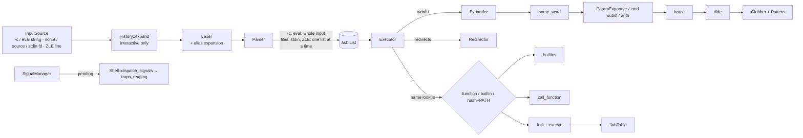

# myzsh implementation plan

A reimplementation of zsh 5.9 in C++26. The repository holds a compiling
skeleton: every header declares the final API, every function body is a stub
that calls `todo("name")` (throws `NotImplemented`) next to a `// TODO(impl):`
comment saying what to build and which part of the zsh source to read. The
tests are complete and currently fail; the work is to make them pass,
milestone by milestone.

```
make build                      # configure (Ninja if present) + build
make unit FILTER='Lexer*'       # unit tests, optionally filtered
make integration FILTER='*A01*' # .ztst cases against build/src/myzsh
make reference                  # the same .ztst cases against the real zsh
make test                       # everything through ctest
grep -rn "TODO(impl)" src       # what is left (364 markers at the start)
```

---

## 1. Scope

In scope (the zsh "core" plus the parts of modules people rely on daily):

- full grammar: lists, pipelines, `&&`/`||`, `!`, `coproc`, subshells,
  `{ }`, `{ } always { }`, `if/elif/else`, `for` (all forms incl. `for ((;;))`
  and `foreach`), `select`, `while/until`, `repeat`, `case` with `;;` `;&`
  `;|`, functions (`f()`, `function f`, multiple names, anonymous), `[[ ]]`,
  `(( ))`, `time`, here-docs, here-strings, all redirection operators,
  MULTIOS, `{var}>` fds, short forms (`if [[ ]] { }`, `for i (a b) cmd`)
- expansion in zsh order: history, alias, process substitution, parameter
  (all flags, modifiers, subscripts, nested `${${x}}`), command substitution,
  arithmetic, brace expansion, tilde/`=cmd`, globbing (extended/ksh glob,
  qualifiers, `**/`), word splitting, quote removal
- parameters: scalars, integers (with base), floats, arrays, associative
  arrays, typeset attributes, tied parameters, dynamic scoping, specials
- the ~185 options, emulation modes (`zsh`, `sh`, `ksh`, `csh`)
- builtins listed in `src/builtins/builtin.h`
- job control, signals, traps (incl. `ZERR`, `DEBUG`, `EXIT`, `TRAPxxx`)
- history (file formats, options, `!` expansion, `fc`)
- prompt expansion
- interactive shell: startup files, ZLE line editor (emacs/vi keymaps,
  kill ring, undo, history search, bracketed paste), basic completion,
  `precmd`/`periodic`/`sched`/mail checks between commands

Out of scope until everything above passes (milestone 13): the compsys
completion framework (`compinit`, `_arguments`, `zstyle`), `zcompile`/`.zwc`,
loadable modules as shared objects (modules we need are compiled in),
`zftp`/`zpty`/`tcp`/`socket`/`db_gdbm`/`curses`, multibyte beyond UTF-8.

---

## 2. Architecture

### 2.1 Where things came from

| zsh source (Src/)                 | myzsh                                  |
|-----------------------------------|----------------------------------------|
| `main.c`, `init.c`                | `main.cpp`, `shell/shell.*`, `shell/cmdline.*` |
| `options.c`                       | `shell/options.*` (table generated from `optns[]`) |
| `input.c`                         | `parse/input.*` (`InputSource`: string, fd) |
| `lex.c`                           | `parse/lexer.*`, `parse/token.*`       |
| `parse.c` (wordcode)              | `parse/parser.*` → `parse/ast.h` (tree) |
| `text.c`                          | `parse/text.*`                         |
| `exec.c`, `loop.c`                | `exec/executor.*`, `exec/redirect.*`   |
| `hashtable.c`                     | `exec/command_hash.*`, `exec/functions.*`, `shell/alias_table.*`, `builtins/builtin.*` |
| `hashnameddir.c`                  | `shell/named_dirs.*`                   |
| `subst.c`                         | `expand/expander.*`, `expand/param_expand.*`, `expand/word.*`, `expand/tilde.*` |
| `glob.c` (braces, filegen)        | `expand/brace.*`, `glob/glob.*`        |
| `pattern.c`                       | `pattern/pattern.*`                    |
| `hist.c` (modifiers, history)     | `expand/modifiers.*`, `history/history.*` |
| `params.c`                        | `params/param.*`, `params/special.*`, `params/subscript.*` |
| `math.c`                          | `arith/arith.*`                        |
| `cond.c`                          | `cond/cond.*`                          |
| `jobs.c`                          | `jobs/jobs.*` (+ wait/fg logic in `Shell`/executor) |
| `signals.c`                       | `signals/signals.*`                    |
| `prompt.c`                        | `prompt/prompt.*`                      |
| `builtin.c`                       | `builtins/*.cpp`, `builtins/printf_format.*` |
| `utils.c` (quoting, splitting)    | `util/strings.*`                       |
| `Zle/zle_*.c`                     | `zle/buffer.*`, `zle/keymap.*`, `zle/display.*`, `zle/terminal.*`, `zle/editor.*` |
| `Zle/compctl.c` (defaults only)   | `complete/completer.*`                 |
| `Modules/parameter.c`             | specials in `params/special.cpp` (`funcstack`, `dirstack`, ...) |

### 2.2 Data flow



### 2.3 Design decisions (and why)

1. **Tree AST instead of wordcode.** zsh compiles to flat wordcode so it can
   share text between functions and support `zcompile`. A `std::variant`
   tree is far easier to build, debug and unit test; `zcompile` is out of
   scope. Function bodies are `shared_ptr<const List>` so the function table
   can outlive the parse.
2. **Words stay raw until execution.** The lexer only finds word boundaries
   (it must understand quotes and `$( )` nesting to do so) and keeps the
   source text. `parse_word()` turns it into parts at expansion time. This is
   what zsh effectively does, and it means `eval`, `${(e)x}`, PROMPT_SUBST and
   here-docs reuse the same code path.
3. **`QString` instead of in-band tokens.** zsh marks special characters by
   replacing them with token bytes (`Star`, `Quest`, `Snull`, ...). We carry a
   parallel `quoted` mask; pattern, brace and glob code consult it. Quote
   removal is then just "use `.text`".
4. **One `Shell` object, no globals.** Everything zsh keeps in globals is a
   member of `Shell`, so tests can create many independent shells in-process.
   The constructor is side-effect free; `init()` (real startup) and
   `init_for_test()` (deterministic, no environment, no rc files) do the work.
   The only process-global state is in `SignalManager`, which is unavoidable.
5. **Errors vs. control flow.** zsh's `errflag` becomes `ShellError`
   (thrown by expansion/assignment/redirection, caught per command line —
   fatal in non-interactive shells). `break`/`continue`/`return`/`exit` are
   *not* exceptions: they set `Shell::flow` and every loop/list checks it,
   exactly like zsh's `breaks`/`retflag`, because `always` blocks, traps and
   `LOCAL_*` restoration must run on the way out.
6. **Pure cores for testability.** Things that do not need the shell take
   plain data: `Pattern`, `Globber` (gets `GlobOptions`), modifiers
   (`ModifierContext`), `JobTable` (wait statuses passed in), `LineBuffer`,
   `Keymap`, `layout_line`, `History`. The parts that need state take
   `Shell&`.
7. **Hand-written argv parsing.** zsh's `+x`, clustered `-xv`, `-o name` and
   "first non-option after -c is `$0`" do not fit CLI11; `parse_command_line`
   and `parse_builtin_args` are small and exact.
8. **Error messages are part of the interface.** Tests compare stderr with
   zsh's text (`zsh:1: command not found: x`, `zsh:cd:1: ...`). Messages are
   produced without the prefix; `Shell::report_error` /
   `report_builtin_error` add `NAME:LINE:` / `NAME:builtin:LINE:`. The
   integration runner rewrites the `myzsh:` prefix to `zsh:` so the same
   expectations work for both shells.
9. **The lexer reads from an `InputSource`, not a string.** (Corrected after
   comparing with jfsh; the original skeleton had `Lexer(strv)` and parsed
   every non-interactive input whole, which is only right for `-c`.) zsh
   parses a script file, a `source`d file and stdin **one top-level list at
   a time**, executing each before reading the next (`loop()` in
   `Src/init.c`), so:
   - a parse error at line 5 still runs lines 1–4 (`s.zsh:5: parse error`);
   - an alias defined in a script/sourced file applies to its later lines;
   - with `zsh < script` or `cmd | zsh`, a `read` in the script consumes the
     **next lines of the script** — the shell must not read stdin ahead of
     the parser.
   `-c` and `eval` still parse the whole string first (§6). Design:
   - `parse/input.h`: `InputSource` with `next_char()`, `unget()`,
     `push_text()` (alias text) and `sync_position()`; subclasses supply
     `read_char()`. `StringInput` holds a `str`; `FdInput` reads an fd it
     does not own. `FdInput` on a seekable fd reads in blocks and
     `sync_position()` `lseek`s back over the unconsumed bytes before any
     command runs; on a pipe/tty it reads one byte at a time (zsh's `SHIN`
     handling with `shinbufreset`). Line counting stays in the `Lexer`.
   - `Lexer(InputSource&)`; `Lexer(strv)` stays as a convenience that wraps
     a `StringInput` (tests, `tokenize`, history word splitting).
   - `Parser::parse_line()` ("next complete list, nullopt at EOF") is the
     incremental entry point; `parse_program()` is used for `-c`/`eval`.
   - `Shell::run_input(InputSource&, strv name)` is the shared loop for
     scripts, `source`/`.`, `-s`/stdin and non-ZLE interactive input:
     parse one list → run → `dispatch_signals()` → repeat. A parse error
     reports, sets status 1 and stops (non-interactive) or discards the line
     (interactive). `run_file` opens the file and calls `run_input`;
     `run_string` keeps the whole-string behaviour.
   - Lexer and parser must keep no state between lists other than pending
     here-documents and line number, so alias changes take effect at the
     next list.
10. **History tracks what is already on disk.** `History` keeps
    `mSavedUpTo` (the first event number not yet written to `HISTFILE`) and
    the file's size/mtime at the last read. Appending writes only
    `[mSavedUpTo, end)` — writing every entry (what a stateless
    `write_file(append=true)` would do) doubles the file each session, which
    is jfsh bug B5. This state is also what `INC_APPEND_HISTORY`,
    `INC_APPEND_HISTORY_TIME` and `SHARE_HISTORY` need: append one entry
    after each command, and (SHARE) read entries other shells appended since
    the last read. Writes are done under an `fcntl` lock (`HIST_FCNTL_LOCK`)
    or zsh's `$HISTFILE.LOCK` file otherwise; rewrites go through a temp file
    and `rename` unless `HIST_SAVE_BY_COPY` is unset.

### 2.4 Coding conventions

The repository's `format-cpp` skill defines the style: 2-space indent,
`struct` over `class`, `lower_snake_case` functions, `UpperCamelCase` types,
`mMember` for private data, header guards, angle-bracket includes, `not`/
`and`/`or`, explicit enum underlying types, `break; case` switch layout with a
`default`, and the aliases in `src/util/aliases.h` (`str`, `strv`, `vec`,
`opt`, `umap`, `uptr`, `sptr`, `s::`, `sf::`, `sc::`). The stubs follow it.
Remove the `-Wno-unused-private-field -Wno-unused-const-variable` lines in the
top-level `CMakeLists.txt` once the stubs are gone.

---

## 3. Milestones

Each milestone lists the files to fill in and the tests that define "done".
Unit test suites are named after the struct/function they test, so
`make unit FILTER='Lexer*:Parser*'` runs exactly one milestone's tests.

### M0 — foundations
- [ ] `util/strings.cpp`: `split_fields` (note: zsh keeps a trailing empty
      field for a trailing non-whitespace IFS char), `split_on`, `join`,
      `is_identifier`, case helpers, `quote`/`unquote` (port `quotestring()`),
      `interpret_escapes` (print vs echo octal rules), `parse_decimal`
- [ ] `shell/options.cpp`: `lookup_option` (case/underscore-insensitive,
      `no` prefix, but `notify` is not `no`+`tify`; bash/ksh aliases),
      `lookup_option_letter` (port `zshletters[]`/`kshletters[]`),
      `option_default`, `OptionState` methods (refuse INTERACTIVE etc.)
- [ ] `parse/token.cpp`: names, `is_redirection`, `reserved_word`
- Done when: `SplitFields* SplitOn* Join* Is* Case* *Quote* Unquote*
  InterpretEscapes* ParseDecimal* Option* LookupOption* TokenHelpers*`

### M1 — lexer, parser, text
- [ ] `parse/input.cpp`: `InputSource`, `StringInput`, `FdInput`
      (§2.3.9); `FdInput` must never consume bytes the parser has not asked
      for on a non-seekable fd, and must hand back read-ahead on a seekable
      one (`sync_position()` called before executing each list)
- [ ] `Lexer` reads through `InputSource&` via its private `next_char()`/
      `unget()` (the `strv` constructor owns a `StringInput`); `incomplete()`
      means "the source hit EOF mid-construct", which drives PS2 in
      interactive mode and a parse error otherwise
- [ ] `parse/lexer.cpp`: context-sensitive tokens (command position, cond
      mode, case patterns), fd numbers, `EnvString`/`EnvArray`, `((` as one
      String up to `))`, comments, backslash-newline, here-doc queue, alias
      push-back with recursion guard, `incomplete()` for PS2
- [ ] `parse/parser.cpp`: the grammar in §1 including the short forms; error
      text `parse error near `X'`, line numbers, `incomplete` flag;
      `parse_line()` stops after one complete list and leaves the source
      positioned right after it (the newline or `;` is consumed, nothing
      more)
- [ ] `parse/text.cpp`: zsh's `functions` format (tabs, `|&` printed as
      `2>&1 |`)
- Done when: `InputSource* FdInput* Lexer* Parser* ParserErrors* Text*`
  (including `Parser.ParseLineIsIncremental` and
  `Parser.ParseLineLeavesRestUnread`)

### M2 — parameters and arithmetic
- [ ] `params/param.cpp`: storage with a per-name definition stack for
      scoping; typed setters honouring attributes (`-i` evaluates arithmetic,
      `-l/-u`, `-L/-R/-Z`, `-U`, readonly → `read-only variable: X`);
      tied scalar/array pairs; environment import/export; `format_float`
      (`%.17g`, `3.` for integral values), `format_integer` (`16#FF`)
- [ ] `arith/arith.cpp`: Pratt parser evaluating as it goes with a no-eval
      flag for short circuits; int64 wrap-around; float promotion; bases
      (`16#ff`, `0x`, `0b`, OCTAL_ZEROES); `##c`/`#name`; all assignment ops;
      `[#16]`/`[##16]`; exact error texts (see `ArithTest.Errors`)
- [ ] `params/special.cpp`: every special listed in `special.h`
- [ ] `params/subscript.cpp`: index/range/flags; assoc `(i)(I)` match keys,
      `(r)(R)` match values, `(k)(K)` treat keys as patterns; assignment to
      elements and slices (padding, deletion with `()`)
- [ ] `Shell::init_for_test()` (needed by most tests from here on)
- Done when: `ParamTableTest* FormatNumbers* MathNumber* ArithTest*
  SpecialParamTest* ParseSubscript* SubscriptEvalTest*`

### M3 — patterns
- [ ] `pattern/pattern.cpp`: compile to nodes, backtracking matcher with
      captures; `[...]` incl. POSIX classes, `<n-m>`, alternation, extended
      glob (`^ ~ # ##`, `(#i/I/l/b/m/aN/s/e)`), ksh glob, file mode;
      prefix/suffix/search with shortest/longest
- Done when: `Pattern* HasGlobChars*`

### M4 — expansion (no subprocesses yet)
- [ ] `expand/word.cpp`, `expand/brace.cpp`, `expand/tilde.cpp`,
      `expand/modifiers.cpp`
- [ ] `expand/param_expand.cpp`: parser for `${...}` and the expansion rules
      of zshexpn(1) "Rules" section, in order
- [ ] `expand/expander.cpp`: prefork, splitting, `"$@"`, RC_EXPAND_PARAM,
      empty-word removal, assignment/scalar/pattern/heredoc contexts
- Done when: `ParseWord* BraceExpansion* TildeTest* *Modifiers*
  ParseParamExpr* ParamExpandTest*` and the non-subprocess part of
  `ExpanderTest*`

### M5 — execution core (first runnable shell)
- [ ] `shell/cmdline.cpp`, `main.cpp` flow, `Shell::init/run/run_string/
      run_file/report_error`
- [ ] `Shell::run_input(InputSource&, strv name)` (§2.3.9): the
      incremental loop used by script files, `source`/`.`, `-s` and stdin;
      `run_string` (whole parse) only for `-c` and `eval`. Pinned by
      `Shell.RunStringParsesWholeStringFirst`,
      `Shell.RunInputRunsListsBeforeParseError`,
      `Shell.RunFileAliasAppliesToLaterLines`,
      `Shell.RunInputLeavesUnparsedStdinForRead`,
      `Shell.RunInputSyncsSeekableStdin`
- [ ] `builtins/builtin.cpp`: `parse_builtin_args`, `BuiltinTable` with
      every name, flags (`BF_SPECIAL`, `BF_ASSIGN`, `BF_PREFIX`)
- [ ] `exec/command_hash.cpp`, `exec/functions.cpp`, `exec/redirect.cpp`
- [ ] `exec/executor.cpp`: lists, sublists, pipelines (last stage in the
      current shell!), simple commands with precommand modifiers, every
      compound command, functions with scoping, assignments, ERR_EXIT/
      ERR_RETURN, XTRACE, `exec_external` (127/126, ENOEXEC → run as script)
- [ ] builtins needed for testing: `: true false print echo exit return
      break continue eval source . set setopt unsetopt typeset local`
- Done when: `CommandLine* Shell* ParseBuiltinArgs* BuiltinTable*
  CommandHashTest* FunctionTable* LoadAutoload* RedirectTest* ExecutorTest*`
  and integration `A01*`–`A07*` mostly pass (`make integration FILTER='*A0*'`),
  including the new `A08input.ztst` (script / stdin modes, see §5)

### M6 — subprocess expansions and globbing
- [ ] command substitution, `$( )` status, process substitution
      (`/dev/fd/N` kept open until the command ends), `=( )` temp files
- [ ] `glob/glob.cpp`: directory walking, `**/` `***/`, qualifiers, sorting,
      NULL_GLOB/NOMATCH/CSH_NULL_GLOB, MARK_DIRS, GLOB_DOTS, GLOB_SUBST
- Done when: `ExpanderTest* GlobTest* ParseGlobQualifiers*`, integration
  `D02* D03* D07* D08*`

### M7 — builtins
- [ ] `builtins/printf_format.cpp` (`FormatPrintf*`)
- [ ] every `bi_*` in `builtins/*.cpp`, in roughly this order: output
      (`print`, `echo`, `printf`), vars (`typeset` family incl. `-p` output,
      `unset`, `set`, `let`), options (`setopt`, `emulate`), dirs (`cd`,
      `pushd`, `popd`, `dirs`, `pwd`), lookup (`whence` family), aliases,
      hash, functions/autoload, read, getopts, test, misc (`umask`, `ulimit`,
      `limit`, `times`, `enable`, `zmodload`)
- [ ] `cond/cond.cpp` (`CondTest*`)
- Done when: `Zsh/BuiltinTest*` (121 cases), `CondTest*`, integration
  `B0* C01* C02* C04* D04* D05* D06* E0*`

### M8 — jobs, signals, traps
- [ ] `jobs/jobs.cpp` bookkeeping and formatting (`[1]  + running    cmd`)
- [ ] `signals/signals.cpp`: names, `TrapTable`, `SignalManager` (handler
      only records; `Shell::dispatch_signals` acts at safe points)
- [ ] executor/shell: process groups and terminal hand-off with MONITOR,
      `wait_for_job`, async notification, `fg bg jobs wait disown kill
      suspend trap` builtins, EXIT/ZERR/DEBUG traps, `TRAPxxx` functions,
      LOCAL_TRAPS
- Done when: `JobTableTest* DescribeWaitStatus* WaitStatus* SignalNames*
  TrapTable* SignalManager*`, integration `C03* W02*`

### M9 — history
- [ ] `history/history.cpp`: storage + options, file read/write (extended
      format, continuation lines), search, `!` expansion with designators
      and modifiers, `^a^b`
- [ ] history file state (§2.3.10): `mSavedUpTo`, last-read size/mtime;
      replace the stateless `write_file(append)` with
      `append_new(path, options)` (only unsaved entries), `rewrite(path,
      limit, options)` (SAVEHIST trim, temp file + rename) and
      `read_new(path)` (entries appended by other shells, for
      SHARE_HISTORY); `fcntl`/`.LOCK` locking; INC_APPEND_HISTORY(_TIME)
      and SHARE_HISTORY wired into `run_interactive`
- [ ] `fc`/`history`/`r` builtins, `print -s`, HISTFILE load/save in
      `Shell::init`/`exit_shell`
- Done when: `HistoryTest* SplitHistoryWords*` (including
  `AppendAcrossSessionsDoesNotDuplicate`, `ReadNewSeesOtherShellsEntries`,
  `GetOutOfRange`, `IgnoreAllDupsKeepsNewest`), integration `W01*`

### M10 — prompts
- [ ] `prompt/prompt.cpp`: all escapes, conditionals, truncation, colours,
      width accounting, PROMPT_SUBST/PERCENT/BANG
- Done when: `PromptTest* DisplayWidth*`, integration `D01*`

### M11 — interactive shell and ZLE
- [ ] `zle/buffer.cpp`, `zle/keymap.cpp` (default keymaps from
      `Zle/zle_bindings.c`), `zle/display.cpp`, `zle/terminal.cpp`,
      `zle/editor.cpp` (widgets listed in `editor.h`, user widgets with
      `BUFFER`/`CURSOR`/`LBUFFER`/`RBUFFER` specials), `bindkey`, `zle`,
      `vared`
- [ ] `Shell::run_interactive`: startup files (§4), PS1/RPS1/PS2, precmd/
      preexec/chpwd hooks, IGNORE_EOF, CHECK_JOBS, job notifications,
      HUP on exit, history integration, history expansion of input lines
      (HIST_VERIFY: put the expanded line back in the editor instead of
      running it). Each prompt cycle, in zsh's order (`Src/init.c` `loop()`,
      `preprompt()`): `dispatch_signals()` → job notifications → `precmd`
      functions → `periodic` when `$PERIOD` has elapsed → `sched` events due
      → mail check (`MAIL`/`MAILPATH`, every `MAILCHECK` seconds) → prompt
- [ ] `sched` builtin and its event queue (`Modules/sched.c`, compiled in),
      also checked while ZLE waits for a key
- [ ] `Shell::preprompt`, `run_sched_events`, `check_mail`, `bi_sched`
      (events in `Shell::sched_events`)
- [ ] ZLE must stay responsive to signals: `Terminal::read_byte` and the
      editor's `KeySource` return a `KeyRead` whose status separates
      `Byte`, `EndOfFile`, `Interrupted` and `TimedOut` (one `nullopt` for
      all of them invites jfsh bug B29: a closed tty spinning at 100% CPU).
      On `Interrupted` the editor runs `dispatch_signals()`; with NOTIFY a
      job finishing prints its status above the prompt and redraws;
      SIGWINCH calls `LineEditor::resize`, which updates `$COLUMNS`/`$LINES`
      and redraws
- [ ] Ctrl-C at the prompt (`send-break`) discards the line and redraws;
      Ctrl-C / Ctrl-Z during a foreground job reach only the job (the shell
      has its own process group and ignores SIGINT/SIGTSTP/SIGTTOU while
      interactive)
- [ ] bracketed paste (`bracketed-paste` widget, `zle_bracketed_paste`)
- Done when: `LineBuffer* KeySequence* Keymap* DefaultKeymaps* KeymapSet*
  Display* EditorTest* TerminalTest* Shell.SchedEventRunsFromPreprompt`,
  and the pty tests (§5) pass

### M12 — completion
- [ ] `complete/completer.cpp`: context classification, commands/files/
      parameters/options/users, common prefix, column listing; wire to
      `expand-or-complete`, `list-choices`, `menu-complete`
- Done when: `CompleterTest* CompletionHelpers*`

### M13 — stretch
- compsys (`compinit`, `compdef`, `_arguments`, `zstyle`, `zsh/complist`)
- more modules: `zsh/datetime` (`strftime`, `EPOCHSECONDS`), `zsh/mathfunc`,
  `zsh/stat`, `zsh/zutil` (`zparseopts`, `zformat`), `zsh/system`, `zsh/pcre`
- `zcompile`, `RE_MATCH_PCRE`, `named references (typeset -n)`, `${| }`
  non-forking substitution (`D10nofork` in zsh's suite)
- port more of zsh's `Test/*.ztst` into `test/integration/cases` (the runner
  understands the same format; see §5)

---

## 4. Startup and shutdown (Shell::init / run / exit_shell)

1. parse argv (`parse_command_line`); `argv[0]` starting with `-` → login;
   basename `sh`/`ksh` → emulation
2. options: emulation defaults, then command-line settings; INTERACTIVE
   defaults to "stdin and stderr are ttys and no -c/script"
3. import environment, install specials, `SHLVL++`, fix `PWD`
4. signals (`SignalManager::install`), terminal and job control when
   interactive (own process group, `tcsetpgrp`)
5. startup files unless NO_RCS (`-f`), each global file skipped with
   NO_GLOBAL_RCS: `/etc/zshenv` → `$ZDOTDIR/.zshenv` → (login)
   `/etc/zprofile`, `.zprofile` → (interactive) `/etc/zshrc`, `.zshrc` →
   (login) `/etc/zlogin`, `.zlogin`. `ZDOTDIR` defaults to `$HOME`.
   While developing, run with `-f` or a private `ZDOTDIR` so your real zsh
   configuration is not executed by a half-finished shell.
6. dispatch: `-c` (whole string parsed first, `run_string`); script file
   and `-s`/stdin (one list at a time, `run_input` over an `FdInput`);
   interactive loop (ZLE, or `run_input` on stdin when not a tty / NO_ZLE)
7. exit: EXIT trap, save history, `.zlogout` for login shells, SIGHUP to jobs
   (unless NO_HUP / disowned)

---

## 5. Testing

### Layout
- `test/unit/*_test.cpp` — GoogleTest, one file per module (~710 tests).
  Tests that need a shell call `test::make_shell()` (uses `init_for_test`);
  `test::run(shell, script)` captures fds 1 and 2; `test::TempDir` and
  `test::ScopedCwd` isolate filesystem tests.
- `test/unit/builtins_test.cpp` — 121 table-driven builtin cases run
  in-process. `python3 test/unit/check_builtin_cases.py /bin/zsh` re-checks
  the whole table against a real zsh (all 121 currently match zsh 5.9).
- `test/integration/cases/*.ztst` — 365 end-to-end cases in zsh's own test
  format, run by `integration_tests` as `myzsh -f -c '...'` in a fresh
  temporary directory. `make reference` runs them against the real zsh;
  all 365 pass there, so any failure against myzsh is a myzsh bug.

### Input modes in the integration runner (to add)
Every case currently runs as `-c`, which parses the whole string first and
so cannot catch incremental-parsing bugs (§2.3.9). Add two flags to the
status line, honoured identically for myzsh and zsh so `make reference`
still validates them:
- `s` — write PREP+CODE to `case.zsh` in the temp directory and run
  `shell -f case.zsh`;
- `i` — feed PREP+CODE on stdin to `shell -f` (the `<` lines are then
  appended after the code, so a `read` in the script consumes them).

New file `A08input.ztst`, at least: parse error late in a script runs the
earlier lines; alias defined in a script applies to later lines (and does
not under `-c`); `source` behaves like a script; `read` from a piped script
reads the following script lines; a here-doc and a multi-line `if` spanning
list boundaries in stdin mode.

### Interactive tests through a pty (to add)
ZLE, job control and signal handling cannot be tested through `-c`.
Add `test/interactive/` driving `myzsh -f -i` under `forkpty` with
`TERM=dumb` and a fixed size: send keys, wait for a prompt marker
(`PS1=$'\n%%PROMPT%% '`), assert on output. Cases: Ctrl-C at the prompt
discards the line; Ctrl-C during `sleep 10` kills only `sleep`; Ctrl-Z
then `fg`; `NOTIFY` message while editing; SIGWINCH updates `$COLUMNS`;
closing the pty master makes the shell exit (not spin); multi-line PS1 is
not reprinted per keystroke; bracketed paste inserts text without running
it. Run the same scenarios against zsh where the output is comparable.

### .ztst format (subset of zsh's)
```
%prep
  setup code, prepended to every test in the file (it shifts line numbers)
%test

<stdin line
  code (indented two spaces)
0:description            status, or - for any; flags d/D skip stdout/stderr,
>expected stdout          f marks a known failure (skipped)
?expected stderr
F:note shown on failure
```

### Workflow per milestone
1. `make unit FILTER='Suite*'` until green
2. `make integration FILTER='*A0*'` for the matching end-to-end cases
3. when adding a behaviour test, run it through `make reference` (or
   `check_builtin_cases.py`) first so the expectation is zsh's, not a guess
4. `make SANITIZE=ON test` before calling a milestone done

---

## 6. Behaviour notes found while writing the tests

Checked against zsh 5.9; each is pinned by a test.

- `zsh -c` parses the **entire** string before running anything: a parse
  error later in the script means nothing runs, and aliases defined in the
  script do not apply to later lines of the same `-c` string (use `eval`).
- Script files, `source`/`.` and stdin are the opposite: parsed and run
  one list at a time. `zsh -f s.zsh` with a parse error on line 5 prints
  lines 1–4's output, then `s.zsh:5: parse error near `('`, status 1; an
  alias defined on line 2 works on line 3. `printf 'read x\nhello\necho
  got=$x\n' | zsh -f` prints `got=hello`.
- In a non-interactive shell an expansion error (`${x:?}`, no glob match,
  bad math) aborts the whole script with status 1 — `always` blocks do not
  get a chance. Builtin `break` outside a loop is fatal too.
- The **last** element of a pipeline runs in the current shell
  (`echo x | read v` sets `v`); `jobs` on the left of a pipe sees an empty
  job table.
- `${x:?}` with no message says `x: parameter not set` even when `x` is set
  but empty.
- IFS splitting keeps a trailing empty field for a trailing non-whitespace
  delimiter: `IFS=:; x=a:b:` → `a b ''`.
- `(t)` of a special exported parameter is `scalar-export-special`.
- `${(V)x}` renders a tab as `\t`, not `^I`.
- `time` only reports for jobs that fork: `time true` prints nothing.
- `|&` is printed by `functions` as `2>&1 |`.
- `set -o` lists default-on options in their `no` form (`noglob off`).
- `%b` in a prompt resets all attributes (`\e[0m`) and then re-emits the
  active colours.
- `echo` needs `\0NNN` for octal; `print` accepts `\NNN` and `\0NNN`.
- printf numeric arguments are arithmetic expressions: `abc` → 0 silently,
  `1x` → error message, prints 0, status 1.
- zsh always defines aliases `run-help=man` and `which-command=whence`.
- `cd` into a CDPATH directory prints it only when interactive.
- `fc -W` writes nothing in a non-interactive shell that never stored
  history; `print -s` entries are visible to `fc -l` though.
- Assoc subscripts: `(i)/(I)` match keys, `(r)/(R)` match values, `(k)/(K)`
  use the stored keys as patterns against the subscript.

### Pitfalls found in jfsh (`../jeff/jfsh/TODO.md` Part 2)

A sibling reimplementation hit these; each deserves a test here.
- Options: `nomatch` and `notify` are real names, not `no`+`match` /
  `no`+`tify`; the caller must learn whether a `no` prefix negated (B15).
- Jobs: job number 0 must never be handed out if 0 means "free" (B4);
  `kill` of a process group must reject pgid ≤ 1 (B17, signals init or
  the shell itself); `%+`/`%-` must be updated when a job is reaped (B41);
  `waitpid` for foreground jobs needs `WUNTRACED` or Ctrl-Z hangs the
  shell (B14).
- History: append mode doubling the file (B5, §2.3.10); `get(0)`
  out-of-bounds (B6); HIST_IGNORE_ALL_DUPS removes the **older** entry and
  keeps the new one (B58).
- Prompt: `%~` must match `$HOME` on a path-component boundary
  (`/Users/ab` is not `~b`) and read `HOME` from the shell's parameters,
  not `getenv` (B36, B61); widths count display columns, not bytes (B25).
- ZLE: Ctrl-C at the prompt (B24), EOF from the terminal (B29), redraw of
  multi-line prompts (B26), SIGWINCH (B27), completion inserts relative to
  the word being completed, not the line (B28).
- ERR_EXIT is applied by the executor with zsh's exemptions, never by the
  REPL on every line (B33).
- Unimplemented builtins must fail loudly — myzsh's `todo()` throws, keep
  it that way rather than returning 0 (B19).

---

## 7. Open questions to settle while implementing

- Startup file names: keep zsh's (`.zshrc`) for fidelity, or add a CMake
  option for a prefix (e.g. `.myzshrc`) during development?
- Locale: tests run with `LC_ALL=C`; decide how far to go with UTF-8 width
  and case conversion (zsh uses `wcwidth`/`towupper`).
- Signal numbers differ between macOS and Linux; tests avoid hard-coding
  them (SIGUSR1 is 30 on macOS, 10 on Linux) — keep it that way.
